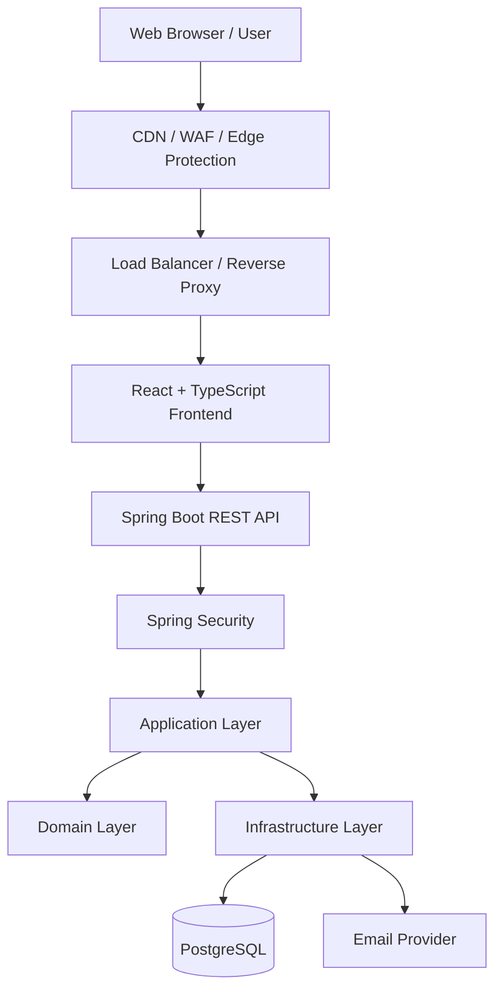

# WorkSphere
## Enterprise Project, Workforce & Collaboration Management Platform

**Product Name:** WorkSphere  
**Product Type:** Enterprise Multi-Tenant SaaS Application  
**Architecture:** Modular Monolith + Clean Architecture + Domain-Driven Design  
**Backend:** Java 21 + Spring Boot  
**Frontend:** React + TypeScript  
**Database:** PostgreSQL  
**Database Migration:** Flyway  
**Initial Infrastructure:** Docker + Docker Compose  
**Target Scale:** Enterprise applications supporting 100,000+ registered users    
**Architecture Philosophy:** Security First, Scalability, Performance, Maintainability, Reliability

**Documentation status:** Proposed architecture baseline; no application is implemented. Start with the [documentation index](docs/README.md) and [ADR index](docs/adr/README.md). Human review is required before ADRs become Accepted or database migrations are generated.

---

# 1. About WorkSphere

## 1.1 What is WorkSphere?

WorkSphere is a secure, enterprise-grade, multi-tenant Software as a Service (SaaS) platform designed to help organizations manage their workforce, teams, projects, tasks, collaboration, communication, and business operations through one centralized application.

The goal is to provide organizations with a unified workspace where employees, managers, team leads, administrators, and business owners can work together efficiently.

WorkSphere brings together:

- Workforce and employee management
- Organization and team management
- Project management
- Task management
- Team collaboration
- Internal communication
- Notifications
- Role-based access control
- Organization-level permissions
- Activity tracking
- Audit logs
- Reporting and analytics
- Enterprise administration

The application will be designed for multiple organizations to use the same SaaS platform while keeping their data securely isolated.

Each organization will have its own workspace, members, projects, tasks, permissions, configurations, and business data.

A user belonging to one organization must never be able to access another organization's private information without an explicitly authorized business mechanism.

WorkSphere is not simply a task management application. It is intended to become a comprehensive enterprise work management and collaboration platform.

## 1.2 Product Vision

Build a powerful, secure, reliable, and scalable digital workplace that allows organizations to manage their people, projects, tasks, and collaboration from one platform.

The long-term vision is to make WorkSphere a platform that can support:

- Small and medium-sized businesses
- Large enterprises
- Multiple departments
- Distributed teams
- Remote workforces
- Complex organizational structures
- Large numbers of users
- Multiple organizations operating independently

The system should be designed to grow without requiring a complete architectural rewrite.

## 1.3 Core Product Principles

1. Security must be part of the architecture from the beginning.
2. Every organization must have strong data isolation.
3. Authorization must be enforced by the backend.
4. Business logic must be independent of infrastructure.
5. Every important business operation should be traceable.
6. Database consistency must be maintained.
7. APIs must be predictable, validated, and documented.
8. The frontend and backend must remain independently maintainable.
9. Performance must be measured rather than assumed.
10. Infrastructure complexity should be introduced only when justified.
11. Code must be testable, maintainable, and understandable.
12. Production readiness must be demonstrated through verification.

---

# 2. Business Problem and Solution

## 2.1 Problems WorkSphere Solves

Many organizations use separate tools for employee management, projects, tasks, communication, notifications, and reporting.

This creates several problems:

- Information is distributed across different systems.
- Employees struggle to understand their responsibilities.
- Managers have difficulty tracking project progress.
- Organizations lack centralized visibility.
- Task ownership and accountability become unclear.
- Communication is disconnected from project work.
- Access permissions are inconsistent.
- Business activity is difficult to audit.
- Sensitive organizational information may be exposed through poorly designed systems.

## 2.2 WorkSphere Solution

WorkSphere provides one centralized workspace.

An organization can:

1. Create its workspace.
2. Invite employees.
3. Organize people into teams and departments.
4. Define roles and permissions.
5. Create projects.
6. Assign employees to projects.
7. Create and assign tasks.
8. Track task progress.
9. Communicate through discussions and comments.
10. Receive notifications.
11. Review project performance.
12. Audit important business activities.

The platform will provide different capabilities depending on the authenticated user's organization membership, role, permissions, and access to individual resources.

---

# 3. Real-World Business Use Case

## 3.1 Example Organization: TechNova

Imagine a company named TechNova with 200 employees.

TechNova has the following departments:

- Engineering
- Human Resources
- Finance
- Marketing
- Quality Assurance

TechNova creates its WorkSphere organization.

The organization owner invites employees and assigns appropriate roles.

### Example users

| User | Role | Responsibilities |
|---|---|---|
| Alice | Organization Owner | Manages organization settings and administration |
| Bob | Engineering Manager | Manages engineering projects |
| Charlie | Team Lead | Manages assigned teams and tasks |
| David | Developer | Works on assigned development tasks |
| Emma | QA Engineer | Handles testing and defect-related tasks |
| Sarah | HR Manager | Manages authorized HR-related activities |

## 3.2 Example workflow

### Step 1: Organization registration

Alice registers on WorkSphere.

She creates an organization named TechNova.

The system creates:

- User account
- Organization
- Organization membership
- Initial owner role assignment
- Audit event

The operation must be transactionally consistent.

### Step 2: Employee invitations

Alice invites Bob, Charlie, David, Emma, and Sarah.

Each invitation:

- Belongs to TechNova.
- Uses a cryptographically secure random token.
- Stores only a protected token representation.
- Has an expiration time.
- Can be used only once.
- Has an explicit invitation status.

After acceptance, the employee becomes an active organization member.

### Step 3: Project creation

Bob creates a project named:

**Banking Application Development**

He assigns Charlie as the team lead and adds David and Emma as project members.

### Step 4: Task creation

Charlie creates tasks:

- Design authentication API
- Implement user registration
- Implement login functionality
- Create PostgreSQL database schema
- Develop frontend login page
- Perform authentication testing

### Step 5: Task assignment

Charlie assigns tasks to David and Emma.

David can view and update tasks he is authorized to access.

Emma can view relevant testing tasks.

### Step 6: Collaboration

Employees can:

- Comment on tasks.
- Discuss project requirements.
- Mention colleagues.
- View relevant activity.
- Receive notifications.

### Step 7: Project monitoring

Bob can monitor:

- Total tasks
- Completed tasks
- Pending tasks
- Delayed tasks
- Project progress
- Employee workload within authorized scope

### Step 8: Audit

Important operations are recorded:

- Employee invitation
- Invitation acceptance
- Role assignment
- Permission changes
- Project creation
- Task assignment
- Task status changes
- Security-related events

## 3.3 Multi-Tenant Security Example

Imagine another company named GlobalTech also uses WorkSphere.

TechNova and GlobalTech share the same SaaS application infrastructure.

However:

- TechNova must not access GlobalTech projects.
- GlobalTech must not access TechNova employees.
- A user cannot access another organization's tasks by changing an ID in an API request.
- Organization IDs supplied by the frontend must never be trusted as proof of access.

Even if a user knows another organization's project UUID, the backend must deny access unless the user has an explicitly authorized relationship with that resource.

This is one of the most important architectural requirements of WorkSphere.

---

# 4. User Types and Roles

WorkSphere will support multiple user categories.

## 4.1 Platform-Level Roles

These roles operate at the SaaS platform level.

### Platform Administrator

Responsible for:

- Platform configuration
- Platform health
- Organization administration
- Platform-level operational tasks
- Support workflows

Platform administrators must not automatically receive unrestricted access to customer business data.

Sensitive support access must be explicitly authorized, limited, audited, and governed.

### Platform Support Agent

Responsible for:

- Customer support
- Account troubleshooting
- Organization support requests

Support permissions should follow least privilege.

## 4.2 Organization-Level Roles

### Organization Owner

- Manages organization settings.
- Manages organization administrators.
- Controls organization-level access.
- Manages organization membership.
- Has designated ownership privileges.

### Organization Administrator

- Manages employees.
- Manages invitations.
- Manages roles and permissions within authorized limits.
- Manages organization settings where permitted.

### Manager

- Manages assigned departments or teams.
- Creates and manages authorized projects.
- Monitors project progress.
- Assigns work.

### Team Lead

- Manages assigned teams.
- Assigns tasks.
- Tracks team progress.
- Coordinates collaboration.

### Employee

- Views authorized projects.
- Manages assigned tasks.
- Participates in discussions.
- Receives notifications.

### Auditor

- Accesses authorized audit information.
- Reviews relevant business activities.
- Does not automatically receive modification permissions.

## 4.3 Custom Roles

The application should eventually support organization-defined roles.

Examples:

- Project Coordinator
- QA Lead
- HR Executive
- Finance Manager
- Department Supervisor

Roles should be collections of permissions rather than hardcoded assumptions about what a particular job title can do.

---

# 5. Main Application Modules

WorkSphere will be organized into business modules.

## 5.1 Identity and Authentication Module

Responsible for user identity and authentication.

Features:

- User registration
- Login and logout
- Email verification
- Password reset
- Password change
- Secure session management
- Session expiration
- Session revocation
- Device and session management
- Login history
- Failed login tracking
- Account recovery
- Multi-factor authentication
- Suspicious authentication detection
- Security notifications

Future possibilities:

- Enterprise SSO
- OAuth 2.0 and OpenID Connect
- Passkeys
- Organization-specific authentication policies

## 5.2 Organization Management Module

Responsible for organization lifecycle and membership.

Features:

- Create organization
- Update organization
- Organization settings
- Organization profile
- Invite employees
- Accept invitations
- Remove members
- Suspend members
- Manage memberships
- Manage departments and teams
- Organization status
- Organization-level configuration

## 5.3 Authorization and Permission Module

Responsible for access control.

Features:

- Role-based access control
- Permission management
- Custom roles
- Role assignment
- Permission revocation
- Organization-level permissions
- Project-level permissions
- Resource-level authorization
- Authorization policies

Authorization must always be checked by the backend.

## 5.4 Project Management Module

Features:

- Create projects
- Update projects
- Archive projects
- Assign project managers
- Add project members
- Remove project members
- Project deadlines
- Project priorities
- Project status
- Project progress
- Project activity history
- Project dashboard

## 5.5 Task Management Module

Features:

- Create tasks
- Update tasks
- Assign tasks
- Reassign tasks
- Task priorities
- Task statuses
- Task deadlines
- Task descriptions
- Task labels
- Task comments
- Task attachments
- Task dependencies
- Task history
- Task filtering
- Task search

## 5.6 Collaboration Module

Features:

- Project discussions
- Task comments
- User mentions
- Team conversations
- Activity feeds
- Collaboration updates
- Real-time updates
- Presence information
- File-sharing workflows

Future capabilities may include advanced chat and collaborative editing.

## 5.7 Notification Module

Features:

- In-app notifications
- Email notifications
- Task assignment notifications
- Project notifications
- Invitation notifications
- Mention notifications
- Security notifications
- Notification preferences
- Read/unread state

## 5.8 Audit Module

Responsible for recording important business and security events.

Examples:

- User registration
- Login success and failure
- Logout
- Organization creation
- Employee invitation
- Membership changes
- Role changes
- Permission changes
- Project creation
- Task assignment
- Task status changes
- Sensitive administrative operations

Audit records should be protected against unauthorized modification and should not contain passwords, session tokens, or unnecessary sensitive data.

## 5.9 Analytics and Reporting Module

Features:

- Organization overview
- Project progress
- Task completion
- Pending tasks
- Delayed projects
- Workload reporting
- Team productivity indicators
- Historical reports

Reports must respect the requesting user's authorization scope.

WorkSphere should focus on useful operational reporting rather than unnecessary employee surveillance.

---

# 6. Technology Stack

## 6.1 Backend Technology

| Technology | Purpose |
|---|---|
| Java 21 | Backend programming language |
| Spring Boot | Backend application framework |
| Spring MVC | REST API development |
| Spring Security | Authentication and authorization |
| Spring Data JPA | Database access |
| Hibernate | ORM |
| Jakarta Validation | Request validation |
| Maven | Dependency and build management |
| Flyway | Database migrations |
| Spring Boot Actuator | Application health and operational endpoints |
| JUnit 5 | Testing |
| Mockito | Unit testing and mocking |
| Testcontainers | Integration testing with real infrastructure |

Use maintained and mutually compatible versions of libraries.

Do not blindly upgrade major versions without compatibility testing.

## 6.2 Frontend Technology

| Technology | Purpose |
|---|---|
| React | Frontend application |
| TypeScript | Type-safe frontend development |
| Vite | Frontend build tooling |
| React Router | Routing |
| TanStack Query | Server-state management |
| React Hook Form | Form management |
| Zod | Frontend schema validation |
| Axios or Fetch | HTTP communication |
| Component library | Reusable UI components |
| Vitest | Frontend unit testing |
| Playwright | End-to-end testing |

The frontend should be responsive, accessible, maintainable, and organized by business features.

## 6.3 Database

**PostgreSQL** will be the primary transactional database.

Responsibilities:

- User information
- Organization information
- Memberships
- Roles
- Permissions
- Projects
- Project memberships
- Tasks
- Comments
- Invitations
- Sessions
- Audit records
- Transactional outbox records

Database schema changes must be managed through Flyway.

Production database schema must never be automatically modified by Hibernate.

## 6.4 Initial Infrastructure

| Technology | Purpose | Initial status |
|---|---|---|
| Docker | Containerization | Initial |
| Docker Compose | Local infrastructure | Initial |
| PostgreSQL | Primary database | Initial |
| Git | Version control | Initial |
| Redis | Caching and ephemeral data | Future |
| Kafka | Event streaming | Future |
| WebSockets | Real-time communication | Future |
| Object storage | File attachments | Introduce when needed |
| API Gateway / Edge Proxy | External traffic management | Deployment stage |
| Kubernetes | Container orchestration | Only if justified |

---

# 7. High-Level System Architecture

## 7.1 Initial Architecture

WorkSphere will initially use a **Modular Monolith**.

A modular monolith means the application is deployed as one backend application, but internally it is separated into well-defined business modules.

This is preferable to starting with microservices because it provides:

- Simpler deployment
- Easier debugging
- Straightforward database transactions
- Lower infrastructure complexity
- Easier local development
- Clear module boundaries
- A path to future service extraction

A modular monolith does not mean one giant codebase without boundaries.

Modules must have clear responsibilities and controlled communication.

## 7.2 High-Level Architecture Diagram



The diagram represents the logical flow. The frontend and backend may be hosted separately or behind the same edge infrastructure.

## 7.3 Backend Request Flow

A typical request follows this sequence:

1. User interacts with the React application.
2. Frontend sends an HTTP request.
3. Edge infrastructure applies relevant network protections.
4. Request reaches the Spring Boot application.
5. Spring Security validates authentication.
6. Application authorization checks the user's permissions.
7. Application layer executes the requested use case.
8. Domain layer enforces business rules.
9. Infrastructure layer interacts with PostgreSQL or external services.
10. Response returns through the API.
11. Frontend updates its interface.

Authentication and authorization are separate responsibilities.

A successfully authenticated user is not automatically authorized to perform every action.

---

# 8. Clean Architecture and Domain-Driven Design

WorkSphere will use Clean Architecture principles with domain-driven design where appropriate.

## 8.1 Architecture Layers

### Presentation Layer

Responsible for:

- REST controllers
- Request DTOs
- Response DTOs
- Input validation
- HTTP status codes
- API documentation
- Exception-to-HTTP mapping

The presentation layer must not contain core business rules.

### Application Layer

Responsible for:

- Use cases
- Application services
- Transaction orchestration
- Input/output ports
- Application workflows
- Coordination between domain objects

Examples:

- RegisterUserUseCase
- CreateOrganizationUseCase
- InviteMemberUseCase
- CreateProjectUseCase
- AssignTaskUseCase

### Domain Layer

Responsible for:

- Entities
- Value objects
- Domain services
- Business rules
- Domain events
- Invariants
- Domain exceptions

The domain layer must not depend on Spring, Hibernate, PostgreSQL, Redis, Kafka, or HTTP.

### Infrastructure Layer

Responsible for:

- Database persistence
- Repository implementations
- External integrations
- Email providers
- Event publishers
- Configuration
- Cache adapters
- Messaging adapters

Infrastructure implements interfaces defined by the application or domain boundaries.

## 8.2 Initial Business Modules

```text
WorkSphere
│
├── identity
├── organization
├── authorization
├── project
├── task
└── audit
```

Collaboration, general notifications and analytics are later-release modules. Release 1 includes only the reliable transactional email delivery needed for verification, password reset and invitations.

Each module owns its business responsibilities.

Modules must not access each other's internal repositories or internal implementation classes directly.

Communication should use deliberate application interfaces or well-defined events.

---

# 9. Backend Spring Boot Structure

The backend will use a feature-oriented modular structure.

Example:

```text
backend/
│
├── pom.xml
│
├── src/
│   ├── main/
│   │   ├── java/
│   │   │   └── com/worksphere/
│   │   │
│   │   │       ├── WorkSphereApplication.java
│   │   │
│   │   │       ├── shared/
│   │   │       │   ├── configuration/
│   │   │       │   ├── exception/
│   │   │       │   ├── security/
│   │   │       │   ├── logging/
│   │   │       │   └── web/
│   │   │
│   │   │       ├── identity/
│   │   │       │   ├── domain/
│   │   │       │   ├── application/
│   │   │       │   ├── infrastructure/
│   │   │       │   └── presentation/
│   │   │
│   │   │       ├── organization/
│   │   │       │   ├── domain/
│   │   │       │   ├── application/
│   │   │       │   ├── infrastructure/
│   │   │       │   └── presentation/
│   │   │
│   │   │       ├── authorization/
│   │   │       ├── project/
│   │   │       ├── task/
│   │   │       └── audit/
│   │   │
│   │   └── resources/
│   │       ├── application.yml
│   │       ├── application-local.yml
│   │       ├── application-test.yml
│   │       └── db/
│   │           └── migration/
│   │
│   └── test/
│       └── java/
│           └── com/worksphere/
│
└── README.md
```

Example module internals:

```text
identity/
│
├── domain/
│   ├── model/
│   ├── valueobject/
│   ├── service/
│   ├── event/
│   └── exception/
│
├── application/
│   ├── usecase/
│   ├── port/
│   │   ├── in/
│   │   └── out/
│   └── service/
│
├── infrastructure/
│   ├── persistence/
│   ├── security/
│   └── configuration/
│
└── presentation/
    └── rest/
        ├── controller/
        ├── request/
        └── response/
```

The same architectural pattern should be applied to other modules where it makes sense.

Avoid creating empty packages or excessive abstractions without a real need.

## 9.1 Backend Engineering Rules

- Controllers must remain thin.
- Business logic belongs in the application and domain layers.
- DTOs must be separate from persistence entities.
- Validate all external input.
- Use transactions deliberately.
- Use explicit repository queries where needed.
- Avoid exposing JPA entities directly through APIs.
- Avoid N+1 queries.
- Paginate collection endpoints.
- Use appropriate database constraints.
- Use architecture tests to protect module boundaries.
- Use consistent exception handling.
- Avoid circular dependencies.
- Avoid giant service classes.
- Avoid putting unrelated responsibilities into shared packages.

---

# 10. Frontend React and TypeScript Structure

The frontend will use a feature-based architecture.

Example:

```text
frontend/
│
├── public/
│
├── src/
│   │
│   ├── app/
│   │   ├── router/
│   │   ├── providers/
│   │   ├── configuration/
│   │   └── layouts/
│   │
│   ├── modules/
│   │   │
│   │   ├── auth/
│   │   │   ├── api/
│   │   │   ├── components/
│   │   │   ├── hooks/
│   │   │   ├── pages/
│   │   │   ├── schemas/
│   │   │   └── types/
│   │   │
│   │   ├── organization/
│   │   ├── members/
│   │   ├── projects/
│   │   └── tasks/
│   │
│   ├── shared/
│   │   ├── components/
│   │   ├── hooks/
│   │   ├── api/
│   │   ├── utilities/
│   │   ├── constants/
│   │   └── types/
│   │
│   ├── assets/
│   ├── styles/
│   ├── tests/
│   │
│   ├── main.tsx
│   └── App.tsx
│
├── package.json
├── tsconfig.json
├── vite.config.ts
└── README.md
```

## 10.1 Frontend Responsibilities

- User interface
- Navigation
- Forms
- Client-side validation
- API communication
- Server-state management
- Loading states
- Error handling
- Responsive layouts
- Accessibility
- User notifications
- Session-expiration handling

## 10.2 Frontend Security Rules

The frontend must never be treated as a security authority.

- Never store long-lived authentication tokens in localStorage.
- Never put secrets into Vite environment variables.
- Never trust frontend role or permission information for authorization.
- Avoid unsafe HTML rendering.
- Validate uploaded files on the backend.
- Use secure browser session handling.
- Handle CSRF protections correctly.
- Avoid exposing sensitive information in browser logs.
- Handle expired sessions safely.
- Avoid unnecessarily caching sensitive responses.

Frontend permission checks may improve the user experience, but the backend must independently authorize every protected operation.

---

# 11. API Architecture

WorkSphere will initially expose versioned REST APIs.

## 11.1 API Base Path

```text
/api/v1
```

All business APIs should use a consistent versioned prefix.

## 11.2 Initial API Design

### Authentication

```http
POST /api/v1/auth/register
POST /api/v1/auth/login
POST /api/v1/auth/logout
POST /api/v1/auth/verify-email
POST /api/v1/auth/forgot-password
POST /api/v1/auth/reset-password
GET  /api/v1/users/me
```

### Organizations

```http
POST   /api/v1/organizations
GET    /api/v1/organizations
GET    /api/v1/organizations/{organizationId}
PATCH  /api/v1/organizations/{organizationId}
POST   /api/v1/organizations/{organizationId}/invitations
GET    /api/v1/organizations/{organizationId}/members
DELETE /api/v1/organizations/{organizationId}/members/{memberId}
```

### Projects

```http
POST   /api/v1/projects
GET    /api/v1/projects
GET    /api/v1/projects/{projectId}
PATCH  /api/v1/projects/{projectId}
DELETE /api/v1/projects/{projectId}
GET    /api/v1/projects/{projectId}/members
POST   /api/v1/projects/{projectId}/members
```

### Tasks

```http
POST   /api/v1/projects/{projectId}/tasks
GET    /api/v1/projects/{projectId}/tasks
GET    /api/v1/tasks/{taskId}
PATCH  /api/v1/tasks/{taskId}
GET    /api/v1/tasks/{taskId}/history
```

These are initial API concepts. Exact request DTOs, response contracts, validation rules, authorization policies, and status codes will be defined before implementation.

## 11.3 API Standards

- Version APIs.
- Validate request bodies and parameters.
- Use appropriate HTTP methods.
- Use appropriate HTTP status codes.
- Use consistent error responses.
- Include pagination.
- Avoid returning internal database structures.
- Avoid leaking sensitive information.
- Use idempotency mechanisms for operations where retries could cause duplicate business actions.
- Document APIs using OpenAPI.
- Apply authorization at the application/resource level.
- Apply request-size and rate limits.
- Use correlation identifiers for tracing.

## 11.4 Standard Error Response

Use a consistent problem-detail response based on RFC 9457.

Example:

```json
{
  "type": "about:blank",
  "title": "Forbidden",
  "status": 403,
  "detail": "You do not have permission to perform this operation.",
  "instance": "/api/v1/projects/123",
  "code": "ACCESS_DENIED",
  "traceId": "example-correlation-id"
}
```

Do not expose stack traces, SQL errors, internal class names, secrets, or sensitive authorization details.

---

# 12. API Gateway and Edge Architecture

## 12.1 What is an API Gateway?

An API Gateway or edge layer is the entry point through which external clients access application services.

It can provide:

- TLS termination
- Request routing
- Rate limiting
- Request-size limits
- IP-based restrictions
- WAF integration
- Traffic management
- Security headers
- Access logging
- Load balancing
- Protection against certain malicious traffic patterns

## 12.2 Initial WorkSphere Approach

Initially, WorkSphere will use a single Spring Boot backend application.

We will not create a separate Spring Cloud Gateway microservice merely for architectural appearance.

The initial deployment can use:

```text
Browser
   |
   v
CDN / WAF
   |
   v
Load Balancer / Reverse Proxy
   |
   v
Spring Boot Application
   |
   v
PostgreSQL
```

The edge layer may be provided by deployment infrastructure or a reverse proxy.

Spring Security will handle application-level authentication and authorization.

The application itself will validate every request regardless of protections applied at the edge.

## 12.3 Future Gateway Evolution

If WorkSphere evolves into multiple independently deployed services, we can evaluate a dedicated API Gateway.

Potential responsibilities:

- Routing to backend services
- Centralized edge policies
- Rate limiting
- Request authentication integration
- Service discovery integration
- API version routing
- Traffic management

The gateway must not become the only place where business authorization is enforced.

Every backend service must independently protect its resources.

---

# 13. Authentication Architecture

Authentication answers:

**Who are you?**

WorkSphere must establish a reliable and secure identity for every user.

## 13.1 Authentication Features

- Registration
- Email verification
- Login
- Logout
- Password reset
- Password change
- Session expiration
- Session revocation
- Login history
- Account recovery
- Suspicious login detection

Multi-factor authentication and enterprise identity federation are deferred beyond Release 1.

## 13.2 Password Security

Passwords must never be stored as plaintext.

Use a maintained password-hashing implementation supporting Argon2id with appropriate parameters.

Requirements:

- Unique salt for every password.
- Appropriate hashing cost.
- Secure password verification.
- Rehashing when parameters become outdated.
- Protection against brute-force attempts.
- Secure password reset tokens.
- No password logging.
- No password exposure in API responses.

Passwords should never be encrypted for later recovery. They should be securely hashed.

## 13.3 Browser Authentication Strategy

The initial browser authentication design uses a server-managed opaque session as specified by [ADR-005](docs/adr/ADR-005-server-managed-browser-sessions.md).

Preferred browser controls:

- Secure cookies
- HttpOnly cookies
- Appropriate SameSite policy
- CSRF protection for state-changing requests
- Session expiration
- Session revocation
- Session rotation after authentication and privilege-sensitive changes
- Secure logout
- No long-lived refresh tokens exposed to JavaScript

If WorkSphere later supports native mobile clients or external third-party API consumers, a separate OAuth 2.0 / OpenID Connect design can be introduced.

Timeouts, limits, CSRF implementation and deployment-origin details remain subject to human approval before implementation.

Do not assume JWT in localStorage is an acceptable enterprise security design.

## 13.4 Session Lifecycle

A typical session lifecycle:

1. User submits login credentials.
2. Backend validates credentials.
3. Backend applies account and abuse-protection checks.
4. Backend establishes an authenticated session.
5. Browser receives the appropriately protected session cookie.
6. Requests are authenticated using the session.
7. Backend checks current membership and permissions.
8. Session expires or is revoked when required.
9. Logout invalidates the server-side session.

Session identifiers must be generated securely and protected from exposure.

---

# 14. Authorization Architecture

Authorization answers:

**What are you allowed to do?**

WorkSphere will use Role-Based Access Control (RBAC) combined with resource-level authorization and policy checks.

## 14.1 RBAC

Permissions are assigned to roles.

Roles are assigned to organization memberships.

Example:

```text
Role: PROJECT_MANAGER

Permissions:
- PROJECT_CREATE
- PROJECT_VIEW
- PROJECT_UPDATE
- PROJECT_ARCHIVE
- PROJECT_MEMBER_ADD
- TASK_CREATE
- TASK_ASSIGN
```

Another example:

```text
Role: EMPLOYEE

Permissions:
- PROJECT_VIEW_ASSIGNED
- TASK_VIEW_ASSIGNED
- TASK_UPDATE_ASSIGNED
- TASK_COMMENT
```

These are illustrative permission sets, not fixed authorization rules for every organization.

## 14.2 Authorization Evaluation

An operation should consider:

- Authenticated user
- Active account status
- Active organization membership
- Organization status
- Role assignments
- Effective permissions
- Resource organization
- Project membership
- Resource ownership or assignment
- Additional business policies

Example:

David attempts to update a task.

The backend must check:

1. Is David authenticated?
2. Is his account active?
3. Does he have an active membership in the task's organization?
4. Does the task belong to that organization?
5. Is David authorized to access the relevant project?
6. Does he have permission to update this task?
7. Do task-specific business rules permit the update?

Only then may the operation proceed.

## 14.3 Security Rules

- Deny by default.
- Enforce authorization on the backend.
- Do not trust role names from the frontend.
- Do not trust organization IDs from the request.
- Do not rely on UUIDs to provide access control.
- Revoke permissions correctly.
- Revalidate membership when performing sensitive actions.
- Audit important role and permission changes.
- Protect administrative endpoints.
- Test both allowed and denied operations.

---

# 15. Multi-Tenant Architecture

Multi-tenancy is a fundamental part of WorkSphere.

## 15.1 Initial Tenant Model

We will initially use:

**Shared PostgreSQL database + shared schema + tenant identifier.**

Tenant-owned records will contain an organization identifier such as:

```text
organization_id UUID NOT NULL
```

Examples:

- Projects
- Project members
- Tasks
- Organization invitations
- Organization settings
- Organization audit events

Global user identity records can exist independently of individual organizations, with access granted through memberships.

## 15.2 Tenant Data Flow

```text
Authenticated User
       |
       v
Resolve Active Organization Membership
       |
       v
Build Trusted Tenant Context
       |
       v
Execute Authorized Use Case
       |
       v
Tenant-Scoped Repository Query
       |
       v
PostgreSQL
```

The tenant context must be derived from trusted server-side authentication and membership information.

A client-provided organization ID is a selection hint, not proof of membership or authorization.

## 15.3 Database-Level Protection

Use:

- Explicit tenant predicates.
- Foreign key constraints.
- Composite foreign keys where needed.
- Unique constraints scoped by organization.
- Appropriate indexes.
- Tenant-aware repository methods.
- Integration tests for cross-tenant access.

PostgreSQL Row-Level Security may be evaluated as defense in depth.

If used, tenant context must be transaction-scoped and handled safely with pooled connections. RLS does not replace application-level authorization.

## 15.4 Critical Tenant Isolation Rule

Every query that accesses tenant-owned data must be tenant-aware.

This includes:

- Read operations
- Write operations
- Updates
- Deletes
- Search
- Reporting
- Exports
- Background jobs
- Asynchronous consumers
- Administrative operations

No feature may bypass tenant authorization merely because it is running internally.

---

# 16. Database Architecture

PostgreSQL is the source of truth for transactional business data.

## 16.1 Initial Logical Database Entities

The authoritative Release 1 physical baseline is [the database design](docs/er-diagram/erd.md). The summary below intentionally excludes deferred product features.

### Identity

- users
- user_sessions
- email_verification_tokens
- password_reset_tokens

### Organization

- organizations
- memberships
- invitations

### Authorization

- roles
- permissions
- role_permissions
- membership_roles

### Projects

- projects
- project_members

### Tasks

- tasks
- task_history

### Audit and Events

- audit_logs
- outbox_events

The outbox is introduced with the first reliable verification, password-reset or invitation email workflow. It is a proposed design, not an implemented component. Comments, teams, labels, dependencies, general notifications, chat and analytics are deferred.

## 16.2 Database Standards

- PostgreSQL is the primary transactional database.
- Use UUID identifiers where appropriate.
- Use Flyway for every schema change.
- Use explicit primary keys and foreign keys.
- Add appropriate unique constraints.
- Add indexes based on query patterns.
- Use appropriate database data types.
- Use transactions for multi-step business operations.
- Avoid unnecessary denormalization.
- Avoid unbounded queries.
- Use pagination.
- Prevent cross-tenant relationships.
- Use database constraints to protect invariants.
- Review migration compatibility before production deployment.
- Maintain backup and restore procedures.
- Define data retention and deletion policies.

## 16.3 Flyway

All database changes must be version-controlled.

Example:

```text
db/migration/
│
├── V1__create_users.sql
├── V2__create_organizations.sql
├── V3__create_memberships.sql
├── V4__create_roles_and_permissions.sql
└── V5__create_projects.sql
```

Never modify an already-applied production migration as a normal schema update.

Create a new migration instead.

Hibernate must not manage production schema evolution through automatic update.

---

# 17. Redis Architecture — Future

Redis is not part of the initial implementation.

We will introduce it only when there is a demonstrated requirement.

## 17.1 Potential Responsibilities

- Frequently accessed data caching
- Distributed rate limiting
- Ephemeral session-related state
- Presence information
- Short-lived coordination data
- Temporary data
- Selected distributed locks, where justified

## 17.2 Cache Strategy

PostgreSQL remains the source of truth.

Redis must not become the authoritative store for critical business data.

Cache design must consider:

- TTL
- Cache invalidation
- Stale data
- Cache stampedes
- Tenant-aware keys
- Data isolation
- Failure behavior
- Cache penetration
- Observability

Example conceptual cache key:

```text
worksphere:organization:{organizationId}:project:{projectId}
```

Sensitive data must not be cached casually.

Redis availability must not silently weaken authorization.

## 17.3 When to Introduce Redis

Potential reasons:

- Database read load becomes significant.
- Repeated expensive reads are measured.
- Distributed rate limiting is required.
- Presence or other ephemeral distributed state is needed.

Do not add Redis merely because the application targets enterprise scale.

---

# 18. Kafka Architecture — Future

Kafka is not part of the initial implementation.

It may be introduced when asynchronous event processing, integration, or event throughput justifies it.

## 18.1 Potential Responsibilities

- Email notification processing
- Audit event processing
- Activity feed updates
- Analytics pipelines
- External integrations
- Background workflows
- Large-scale event processing

## 18.2 Event-Driven Architecture

Example:

```text
Task Application Service
          |
          v
     PostgreSQL
          |
          v
   Transactional Outbox
          |
          v
    Event Publisher
          |
          v
        Kafka
          |
    +-----+------+
    |            |
    v            v
Notification   Analytics
Consumer       Consumer
```

## 18.3 Important Kafka Requirements

- Transactional outbox pattern.
- Idempotent consumers.
- Retry policies.
- Dead-letter queues.
- Event versioning.
- Duplicate message handling.
- Event ordering where required.
- Consumer lag monitoring.
- Tenant context propagation.
- Sensitive data minimization.

A Kafka event must not be trusted as proof that a consumer is authorized to access arbitrary tenant data.

## 18.4 When to Introduce Kafka

Potential reasons:

- Background workloads become substantial.
- Multiple independent consumers require the same events.
- Integrations need reliable asynchronous delivery.
- Processing must be decoupled from request latency.
- Event volume justifies a message streaming platform.

Initially, simpler application-level asynchronous processing and an outbox foundation may be sufficient.

---

# 19. WebSockets and Real-Time Communication — Future

WebSockets are not part of the initial implementation.

The initial application can use ordinary REST APIs.

WebSockets may later support:

- Live task updates
- Project activity updates
- Real-time notifications
- User presence
- Collaboration updates
- Live discussion features

## 19.1 Future WebSocket Architecture

```text
React Frontend
      |
      v
Authenticated WebSocket Connection
      |
      v
Spring Boot WebSocket Endpoint
      |
      v
Authentication + Authorization
      |
      v
Authorized Organization / Project Channels
      |
      v
Real-Time Event Delivery
```

## 19.2 WebSocket Security

- Authenticate connections.
- Validate allowed origins.
- Authorize subscriptions.
- Enforce tenant isolation.
- Enforce project-level access.
- Validate message payloads.
- Apply connection and message limits.
- Protect against unauthorized channel subscriptions.
- Handle session expiration and revocation.
- Monitor connection counts.

A user must not be able to subscribe to another organization's channel by guessing its name or identifier.

For horizontally scaled deployments, distributed messaging or a suitable broker may be needed to coordinate events between application instances.

---

# 20. Security Architecture

Security is a core product requirement, not a later enhancement.

WorkSphere will follow defense-in-depth, least privilege, secure defaults, and zero-trust principles.

## 20.1 Security Objectives

Protect:

- User accounts
- Organization data
- Employee information
- Projects
- Tasks
- Business conversations
- Files
- Sessions
- Audit records
- Application infrastructure
- Secrets and credentials

## 20.2 Application Security

Use:

- Spring Security
- Secure password hashing
- Secure session handling
- CSRF protection
- Request validation
- Authorization policies
- Rate limiting
- Secure error handling
- Security headers
- Restricted CORS policies
- Request-size limits
- Safe file-upload handling

## 20.3 Network Security

Production deployment should include:

- HTTPS
- TLS configuration
- Firewall rules
- Private database networking
- Restricted service access
- WAF where appropriate
- Secure ingress
- Network segmentation where justified

Never expose the database publicly without a compelling, reviewed requirement.

## 20.4 Data Security

- Encrypt data in transit.
- Encrypt disks and backups.
- Use managed key storage where available.
- Protect sensitive configuration.
- Minimize stored personal information.
- Apply appropriate data retention.
- Restrict access to production data.
- Sanitize production data before using it in non-production environments.

Application-level encryption should be introduced for specific sensitive fields when the threat model and data requirements justify it.

## 20.5 OWASP Security

Security engineering should be informed by:

- OWASP Top 10
- OWASP API Security Top 10
- OWASP Application Security Verification Standard
- Secure coding practices
- Dependency vulnerability management

Security testing should include:

- Broken access control
- Authentication failures
- Authorization bypass
- Cross-tenant access
- SQL injection
- Cross-site scripting
- Cross-site request forgery
- Insecure direct object references
- Mass assignment
- Session attacks
- Brute-force attacks
- Rate-limit bypass
- Malicious uploads
- Sensitive data exposure
- Dependency vulnerabilities

## 20.6 Audit and Security Monitoring

Record important security and administrative events.

Examples:

- Successful login
- Failed login
- Password reset
- Session revocation
- MFA changes
- Membership changes
- Role changes
- Permission changes
- Administrative operations
- Cross-tenant access denials where appropriate

Do not store passwords, authentication secrets, raw session tokens, or unnecessary personal data in audit logs.

---

# 21. Performance and Scalability Architecture

WorkSphere should be designed to support enterprise growth.

However, 100,000 registered users does not mean 100,000 concurrent users.

Actual infrastructure sizing must be based on workload measurements.

The 100,000 registered-user target is a product aspiration, not a verified capacity. Until representative load and recovery tests run, these are provisional planning assumptions rather than guarantees:

| Dimension | Provisional assumption |
|---|---|
| Organizations | 5,000 registered; 1,000 monthly active |
| Active users | 25,000 monthly active out of 100,000 registered |
| Peak concurrent sessions | 2,000 |
| Largest tenant | 10,000 memberships; 2,000 concurrently active users |
| Projects and tasks | Up to 10,000 projects and 2,000,000 retained tasks in the largest tenant |
| Request rate | 250 requests/second sustained; 750 requests/second short peak platform-wide |
| Latency | P95 under 300 ms and P99 under 1 second for ordinary non-reporting APIs, excluding external email latency |
| Availability | Provisional 99.9% monthly service objective until a formal SLO is approved |
| Recovery | Proposed RPO 5 minutes and RTO 60 minutes |
| Retention | Active customer lifecycle; security audit at least 365 days provisionally; successful outbox 30 days and failed outbox 90 days, subject to legal/customer approval |

Dataset shape, hot-tenant behavior, query plans, connection limits, failure recovery and backup restoration must be measured in a production-like environment before making a capacity or SLO claim.

## 21.1 Backend Scalability

Design for:

- Stateless request processing where practical.
- Multiple backend instances.
- Externalized session state if distributed sessions are required.
- Connection pool management.
- Bounded request processing.
- Timeouts.
- Pagination.
- Query optimization.
- Horizontal scaling.
- Controlled background processing.

## 21.2 Database Performance

Use:

- Appropriate indexes.
- Query analysis.
- Efficient joins.
- Pagination.
- Connection pooling.
- Transaction management.
- Query monitoring.
- Database resource monitoring.
- Read replicas when justified.
- Partitioning only when actual workload requires it.

## 21.3 Performance Testing

Performance requirements must be measured.

Initial proposed targets, subject to workload validation:

| Metric | Proposed target |
|---|---|
| Availability | 99.9% monthly |
| Ordinary read API | p95 under 300 ms |
| Ordinary write API | p95 under 500 ms |
| Error rate | Below 0.1% under normal healthy conditions |
| Horizontal scalability | Supported by deployment design |

These are engineering targets, not current guarantees.

Load testing must model:

- Concurrent users
- Request rates
- Read/write ratios
- Authentication activity
- Large organizations
- Large projects
- Task searches
- Reporting workloads
- Background jobs

---

# 22. Observability and Monitoring

Production WorkSphere must be observable.

## 22.1 Logging

Use structured logs.

Include appropriate information such as:

- Timestamp
- Log level
- Service name
- Environment
- Correlation ID
- Trace ID
- Request information
- Safe error information

Never log passwords, cookies, access tokens, refresh tokens, or secrets.

## 22.2 Metrics

Monitor:

- Request rate
- Request latency
- HTTP error rate
- JVM memory
- Garbage collection
- Database connections
- Database query performance
- Connection pool saturation
- Background job failures
- Queue lag when messaging is introduced

## 22.3 Tracing

Use distributed tracing when useful.

Potential technologies:

- Micrometer
- OpenTelemetry
- Prometheus
- Grafana
- Centralized log aggregation

Spring Boot Actuator should expose only appropriately protected operational endpoints.

Health endpoints must not expose secrets or sensitive internal information.

---

# 23. Deployment Architecture

## 23.1 Local Development

Initial local environment:

```text
Windows 10/11
      |
      +---- Git
      |
      +---- Java 21
      |
      +---- Maven
      |
      +---- Node.js
      |
      +---- Docker Desktop
                 |
                 +---- PostgreSQL
```

Backend and frontend can initially run directly on the development machine, with PostgreSQL running in Docker Compose.

## 23.2 Production Deployment

Conceptual deployment:

```text
                  Internet
                     |
                     v
                 DNS / CDN
                     |
                     v
                  WAF / Edge
                     |
                     v
              Load Balancer
                     |
          +----------+----------+
          |                     |
          v                     v
      Frontend              Backend
      Hosting               Instances
                                |
                                v
                           PostgreSQL
                                |
                         +------+------+
                         |             |
                         v             v
                       Email        Backups
                     Provider
```

Additional infrastructure can be introduced as requirements grow:

- Redis
- Kafka
- Object storage
- Dedicated workers
- WebSocket infrastructure
- Read replicas
- Centralized monitoring

## 23.3 Environment Separation

Maintain separate environments:

- Local
- Development
- Testing
- Staging
- Production

Each environment must have independent configuration and credentials.

Production secrets must never be committed to Git.

Production data must not be copied into development environments without an approved sanitization process.

---

# 24. Testing Strategy

Testing is mandatory at every milestone.

## 24.1 Backend Unit Testing

Use JUnit 5 and Mockito.

Test:

- Domain rules
- Application use cases
- Validation behavior
- Authorization decisions
- Business exceptions
- State transitions

## 24.2 Integration Testing

Use Testcontainers where appropriate.

Test:

- PostgreSQL integration
- Flyway migrations
- Repository behavior
- Transactions
- Database constraints
- Tenant-scoped queries
- API integration

## 24.3 Security Testing

Test:

- Unauthenticated requests
- Unauthorized requests
- Invalid sessions
- Expired sessions
- Permission revocation
- Cross-tenant access
- Privilege escalation attempts
- Invalid invitation tokens
- Brute-force protections

## 24.4 Frontend Testing

Use:

- Vitest
- React Testing Library
- Playwright

Test:

- Component behavior
- Form validation
- Routing
- Error handling
- Session expiration
- Important user workflows
- End-to-end business journeys

## 24.5 Architecture Testing

Enforce:

- Module boundaries
- Dependency direction
- No forbidden dependencies
- No circular module dependencies

---

# 25. Development Roadmap and Milestones

WorkSphere will be built incrementally.

A milestone must pass its acceptance criteria before the next milestone begins.

## Milestone 0 — Project Governance

- Establish repository instructions.
- Create AGENTS.md.
- Create architecture documentation.
- Define security baseline.
- Define coding standards.
- Define Definition of Done.
- Define development workflow.

## Milestone 1 — Development Foundation

- Install development tools.
- Configure Java 21.
- Configure Maven.
- Configure Node.js.
- Configure Docker.
- Create Spring Boot backend.
- Create React frontend.
- Configure PostgreSQL.
- Configure Flyway.
- Configure health checks.
- Establish testing foundations.

## Milestone 2 — Architecture and Database

- Finalize module boundaries.
- Design the database ER diagram.
- Define entities and relationships.
- Define primary and foreign keys.
- Define tenant constraints.
- Define indexes.
- Review and approve proposed ADRs.
- Prepare the first small Flyway migrations only after approval.
- Establish architecture-test foundations.

## Milestone 3 — Identity and Authentication

- User registration.
- Password hashing.
- Email verification.
- Login.
- Logout.
- Session management.
- Password reset.
- Account protection.
- Authentication security tests.

## Milestone 4 — Organization and Authorization

- Organization creation.
- Membership management.
- Invitation workflow.
- RBAC.
- Permission management.
- Tenant context.
- Resource-level authorization.
- Cross-tenant security tests.

## Milestone 5 — Project Management

- Project creation.
- Project updates.
- Project membership.
- Project permissions.
- Project status.
- Project history.

## Milestone 6 — Task Management

- Task creation.
- Task assignment.
- Task updates.
- Task status.
- Task priorities.
- Task history.

## Milestone 7 — Frontend Application

- Application shell.
- Login and registration screens.
- Organization workspace.
- Dashboard.
- Member management.
- Project screens.
- Task screens.
- API integration.
- Frontend security.

## Milestone 8 — Collaboration and Notifications

- Teams.
- Comments.
- Mentions.
- In-app notifications.
- Advanced email notifications.
- Activity feed.
- Background processing.
- Attachments, chat and task dependencies as prioritized.

## Milestone 9 — Security Hardening

- Threat-model review.
- Security testing.
- Dependency scanning.
- Rate limiting.
- Security headers.
- Authorization review.
- Session review.
- Tenant-isolation review.
- Vulnerability remediation.

## Milestone 10 — Performance Engineering

- Load testing.
- Database profiling.
- Query optimization.
- Connection pool tuning.
- Caching assessment.
- Capacity testing.

Redis may be introduced if justified by measured requirements.

## Milestone 11 — Production Engineering

- CI/CD.
- Container image hardening.
- Production configuration.
- Secrets management.
- Monitoring.
- Logging.
- Tracing.
- Database backups.
- Recovery testing.
- Deployment strategy.

Kafka and WebSockets may be introduced if justified by product and operational requirements.

## Milestone 12 — Enterprise Capabilities

- Advanced MFA.
- SSO.
- Enterprise identity integrations.
- Advanced audit.
- Advanced analytics.
- Integrations.
- Data retention controls.
- Disaster recovery improvements.
- Compliance preparation.

---

# 26. Release Strategy

## Release 1 — Core WorkSphere MVP

The first release should contain:

- User registration and login
- Email verification
- Server-managed opaque sessions
- Logout and password reset
- Organization creation
- Invitations and memberships
- Organization-scoped RBAC
- Projects and project membership
- Tasks and assignments
- Minimal audit history
- Basic React dashboard
- Tenant-isolation and security tests

Reliable transactional email for verification, reset and invitations is supporting infrastructure. Teams, comments, attachments, chat, analytics, MFA, SSO, Redis, Kafka and WebSockets are not Release 1 product scope.

The first release must not compromise security to deliver features faster.

## Release 2 — Collaboration and Scale

Potential features:

- Teams and comments
- Redis caching where justified
- Kafka-based asynchronous workflows where justified
- WebSocket-based real-time updates
- Advanced notifications
- File attachments
- Advanced search
- Analytics
- Improved audit capabilities

## Release 3 — Enterprise Expansion

Potential features:

- Enterprise SSO
- Advanced MFA policies
- Advanced organization administration
- Advanced reporting
- External integrations
- Disaster recovery
- High-availability architecture
- Enterprise security and compliance controls

---

# 27. Architecture Decision Principles

Major technical decisions must be documented as Architecture Decision Records (ADRs).

Initial decisions:

| ADR | Decision | Status |
|---|---|---|
| [ADR-001](docs/adr/ADR-001-modular-monolith.md) | Modular monolith | Proposed |
| [ADR-002](docs/adr/ADR-002-shared-schema-multi-tenancy.md) | Shared-schema multi-tenancy | Proposed |
| [ADR-003](docs/adr/ADR-003-global-users-and-memberships.md) | Global users and memberships | Proposed |
| [ADR-004](docs/adr/ADR-004-global-permissions-organization-roles.md) | Global permissions and organization roles | Proposed |
| [ADR-005](docs/adr/ADR-005-server-managed-browser-sessions.md) | Server-managed browser sessions | Proposed |
| [ADR-006](docs/adr/ADR-006-tenant-aware-composite-foreign-keys.md) | Tenant-aware composite foreign keys | Proposed |
| [ADR-007](docs/adr/ADR-007-flyway-database-migrations.md) | Flyway migrations | Proposed |
| [ADR-008](docs/adr/ADR-008-transactional-outbox-strategy.md) | Transactional outbox strategy | Proposed |
| [ADR-009](docs/adr/ADR-009-mvp-scope.md) | MVP scope | Proposed |
| [ADR-010](docs/adr/ADR-010-pragmatic-clean-architecture.md) | Pragmatic Clean Architecture | Proposed |

No major architectural change should happen silently.

Document the context, alternatives, trade-offs, and consequences.

---

# 28. Definition of Done

A feature is not complete simply because its code has been written.

Every feature must satisfy applicable requirements:

- Correct business behavior.
- Approved architecture followed.
- Input validation implemented.
- Authentication handled.
- Authorization enforced.
- Tenant isolation verified.
- Appropriate database constraints.
- Transactions handled correctly.
- Unit tests written.
- Integration tests written where appropriate.
- Security tests written where appropriate.
- API documentation updated.
- Error handling implemented.
- Logging implemented without exposing sensitive information.
- No secrets committed.
- Code reviewed.
- Build and tests pass.
- Documentation updated.

Security-critical features must never be marked complete based only on frontend behavior or successful manual testing.

---

# 29. Important Risks to Prevent

The following risks must be considered throughout development.

| Risk | Required prevention |
|---|---|
| Cross-tenant data leakage | Tenant-scoped authorization and database constraints |
| Broken access control | Explicit backend permission checks |
| Privilege escalation | Controlled role and permission management |
| Credential exposure | Secure hashing, sessions and secret management |
| SQL injection | Parameterized database access |
| Insecure APIs | Validation, authorization and rate limiting |
| Cache data leakage | Tenant-aware cache keys and access policies |
| Duplicate event processing | Idempotent consumers |
| Database performance degradation | Indexing, profiling and query optimization |
| Data loss | Backups and recovery testing |
| Malicious uploads | File validation, scanning and storage isolation |
| Administrative misuse | Least privilege and auditable operations |
| Deployment failure | CI/CD checks, safe migrations and rollback planning |

---

# 30. Guiding Engineering Rules for Codex and Developers

All contributors, including AI coding agents, must follow these rules.

1. Read the repository's AGENTS.md before implementing changes.
2. Read the architecture and security documentation.
3. Work on one approved milestone at a time.
4. Inspect existing code before changing it.
5. Do not silently change the technology stack.
6. Do not introduce unnecessary microservices.
7. Do not add Redis or Kafka before the relevant milestone.
8. Do not implement future features prematurely.
9. Keep business logic out of controllers.
10. Keep domain logic independent of infrastructure.
11. Enforce tenant isolation on every relevant operation.
12. Never trust frontend authorization.
13. Never expose secrets or credentials.
14. Write meaningful tests.
15. Verify migrations against a clean database.
16. Report actual test results.
17. Document important architecture decisions.
18. Keep changes small and reviewable.
19. Commit completed milestones.
20. Never claim production readiness without appropriate verification.

When requirements are unclear, ask before making consequential architectural decisions.

---

# 31. Final Product Direction

WorkSphere is intended to become a secure, scalable, maintainable enterprise SaaS platform that brings workforce management, project management, task management, collaboration, authorization, and organizational operations into one unified workspace.

The initial implementation will prioritize:

1. A correct product and domain model.
2. A secure identity foundation.
3. Strong multi-tenant isolation.
4. Reliable authorization.
5. A maintainable Spring Boot backend.
6. A scalable React frontend.
7. A well-designed PostgreSQL database.
8. Automated testing.
9. Production-oriented observability.
10. A reliable deployment foundation.

The initial architecture will remain a modular monolith.

Redis, Kafka, WebSockets, and a dedicated API Gateway will be introduced only when justified by actual technical or business requirements.

The objective is not to build the most complicated architecture.

The objective is to build the **right architecture**, with strong security and engineering discipline, that can evolve into a large enterprise platform without losing reliability, maintainability, or performance.

---

**WorkSphere — One Workspace. Connected Teams. Better Work.**
