# WorkSphere — System Design Document
## High-Level Design (HLD) and Low-Level Design (LLD)

**Product:** WorkSphere  
**Document:** System Design Specification  
**Version:** 1.0  
**Status:** Initial Architecture Baseline  
**Architecture Style:** Modular Monolith, Clean Architecture, Domain-Driven Design  
**Backend:** Java 21, Spring Boot, Maven  
**Frontend:** React, TypeScript, Vite  
**Database:** PostgreSQL  
**Migration Management:** Flyway  
**Initial Infrastructure:** Docker, Docker Compose  
**Future Infrastructure:** Redis, Kafka, WebSockets, Object Storage  
**Target:** Enterprise Multi-Tenant SaaS Platform

---

# PART A — SYSTEM DESIGN OVERVIEW

# 1. Purpose of This Document

This document defines the technical system design of WorkSphere.

It describes:

1. High-Level Design (HLD).
2. Low-Level Design (LLD).
3. System architecture.
4. Application components.
5. Frontend architecture.
6. Backend architecture.
7. API architecture.
8. Authentication and authorization.
9. Multi-tenant architecture.
10. Database design.
11. Business workflows.
12. Security architecture.
13. Future distributed infrastructure.
14. Deployment architecture.
15. Testing and performance strategy.

This document will serve as the technical reference for developers, architects, reviewers, and AI coding agents.

All implementation decisions must remain consistent with this document or be recorded as approved Architecture Decision Records (ADRs).

---

# PART B — HIGH-LEVEL DESIGN (HLD)

# 2. HLD Introduction

High-Level Design describes the overall architecture of the application.

It answers:

- What components exist?
- What responsibilities do they have?
- How do they communicate?
- Where is data stored?
- How are requests processed?
- How is security enforced?
- How will the system scale?

WorkSphere will initially be developed as a modular monolith.

The architecture will preserve clear boundaries so that individual modules can potentially become independent services in the future.

We will not start with microservices.

---

# 3. System Requirements

## 3.1 Functional Requirements

The system must support:

| ID | Requirement |
|---|---|
| FR-01 | User registration and authentication |
| FR-02 | Email verification and password recovery |
| FR-03 | Organization creation and management |
| FR-04 | Employee invitations and membership management |
| FR-05 | Role and permission management |
| FR-06 | Multi-tenant data isolation |
| FR-07 | Project creation and management |
| FR-08 | Project membership |
| FR-09 | Task creation and assignment |
| FR-10 | Task status and priority management |
| FR-11 | Reliable verification, password-reset and invitation email delivery |
| FR-12 | Basic React dashboard |
| FR-13 | Audit logging |

Task comments, discussions, general notifications, reporting/analytics and advanced administration are product requirements for later releases, not Release 1 requirements.

## 3.2 Non-Functional Requirements

| Category | Requirement |
|---|---|
| Security | Authentication, authorization, tenant isolation |
| Availability | Initial target: 99.9% monthly |
| Performance | Initial read API target: p95 below 300 ms |
| Performance | Initial write API target: p95 below 500 ms |
| Scalability | Horizontal backend scaling |
| Maintainability | Modular architecture |
| Reliability | Transactional consistency |
| Observability | Logs, metrics and traces |
| Recoverability | Proposed RPO 5 minutes and RTO 60 minutes, subject to infrastructure validation |
| Compatibility | Modern supported browsers |
| Accessibility | Accessible and responsive frontend |

These are proposed engineering targets. They must be validated through workload modelling, testing and production measurements. The 100,000 registered-user aspiration is not a concurrency or throughput guarantee.

### 3.3 Provisional workload assumptions

| Dimension | Assumption for initial testing |
|---|---|
| Organizations | 5,000 registered; 1,000 monthly active |
| Active users | 25,000 monthly active out of 100,000 registered |
| Peak concurrent sessions | 2,000 |
| Largest tenant | 10,000 memberships; 2,000 concurrently active users |
| Projects/tasks | 10,000 projects and 2,000,000 retained tasks in the largest tenant |
| Request rate | 250 requests/second sustained; 750 requests/second short peak |
| Latency | Ordinary API P95 below 300 ms and P99 below 1 second, excluding external email |
| Availability | Provisional 99.9% monthly service objective |
| Recovery | Proposed RPO 5 minutes and RTO 60 minutes |
| Retention | Active customer lifecycle; audit at least 365 days provisionally; outbox success 30 days/failure 90 days |

These values size test scenarios only. They are not tested guarantees. Hot-tenant distribution, query plans, connection limits, restore time and failure behavior must be measured in a production-like environment. Retention requires legal/customer approval.

---

# 4. HLD — Overall System Architecture

## 4.1 System Context

WorkSphere has several external actors:

- Employees
- Managers
- Organization owners
- Organization administrators
- Platform administrators
- External email providers
- Future enterprise identity providers

The application provides a centralized workspace for all authorized users.

### Context Diagram

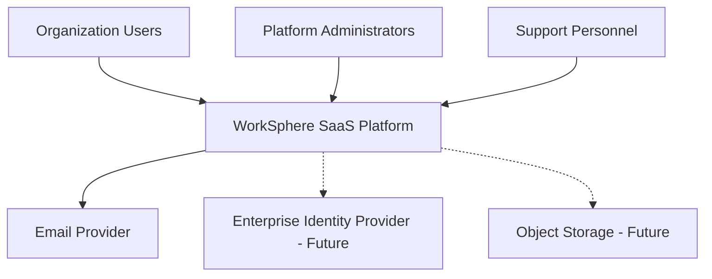

External integrations must use authenticated and appropriately authorized interfaces.

---

# 5. HLD — Logical Architecture

## 5.1 Main Architecture

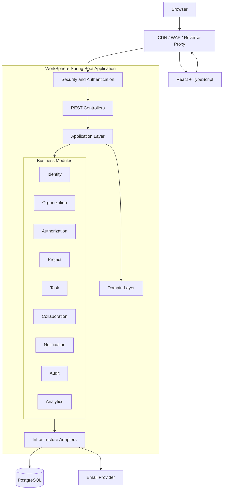

The diagram represents logical responsibilities. In the initial deployment, frontend hosting, edge routing and backend hosting may be separate or combined behind a reverse proxy.

## 5.2 Component Responsibilities

| Component | Responsibility |
|---|---|
| CDN | Static asset delivery |
| WAF | Edge traffic protection |
| Reverse Proxy | Routing and TLS termination |
| React Frontend | User interface |
| Spring Security | Authentication and security filters |
| REST Controllers | HTTP request and response handling |
| Application Layer | Use-case execution |
| Domain Layer | Business rules |
| Infrastructure | Database and external integrations |
| PostgreSQL | Transactional source of truth |
| Email Provider | Email delivery |

## 5.3 Initial Architecture Decision

The initial system will contain:

- One Spring Boot backend application.
- One React frontend application.
- One PostgreSQL database.
- One local Docker Compose infrastructure definition.

The system will not initially require:

- A dedicated API Gateway service.
- Redis.
- Kafka.
- WebSockets.
- Kubernetes.
- Microservices.

The architecture must not depend on those future components being available.

---

# 6. HLD — Frontend Architecture

## 6.1 Frontend Component Design

The frontend is a React and TypeScript application.

Responsibilities:

- Rendering user interfaces.
- Navigation.
- Form handling.
- API communication.
- Server-state management.
- Error handling.
- Session-expiration handling.
- Responsive layouts.
- Accessibility.

The frontend is not responsible for enforcing security.

## 6.2 Frontend Architecture Diagram

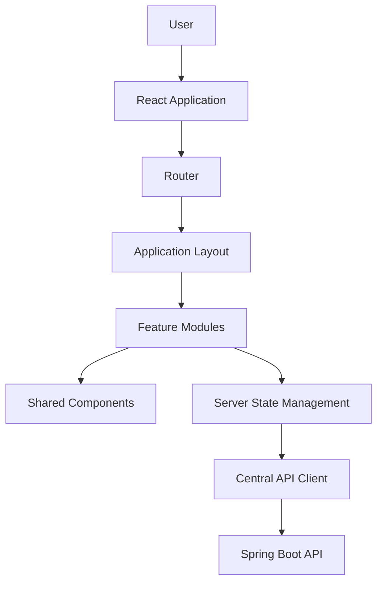

## 6.3 Frontend Modules

- Authentication
- Organization
- Members
- Projects
- Tasks
- Collaboration
- Notifications
- Analytics
- Administration

## 6.4 Frontend Data Flow

1. User opens a page.
2. Router resolves the route.
3. The feature component loads.
4. The component requests data through the centralized API client.
5. The API client sends the request with the appropriate browser session credentials.
6. Backend processes and authorizes the request.
7. Backend returns a response.
8. TanStack Query manages server-state caching and updates.
9. React renders the result.

Sensitive server data must not be cached beyond its intended authorization scope.

---

# 7. HLD — Backend Architecture

## 7.1 Backend Architecture Pattern

The backend will use:

- Modular Monolith
- Clean Architecture
- Domain-Driven Design
- Explicit module boundaries
- Dependency inversion

The backend is deployed as one application but organized as independent business modules.

## 7.2 Backend Modules

| Module | Responsibility |
|---|---|
| Identity | Users, credentials, sessions |
| Organization | Organizations and memberships |
| Authorization | Roles, permissions and policies |
| Project | Projects and project members |
| Task | Tasks, assignments and history |
| Audit | Business and security event history |

Collaboration, general notifications and analytics are deferred beyond Release 1. Reliable email for verification, reset and invitations is delivered through the identity/organization workflows and transactional outbox.

## 7.3 Dependency Direction

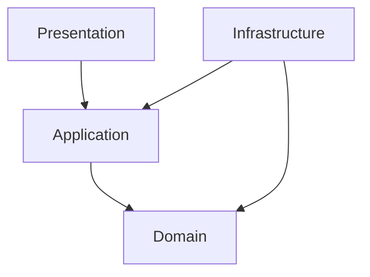

Important rules:

- Domain must not depend on Spring.
- Domain must not depend on Hibernate.
- Domain must not depend on PostgreSQL.
- Application defines the operations it needs.
- Infrastructure implements the required interfaces.
- Controllers must not access database implementations directly.

## 7.4 Cross-Module Communication

Modules communicate through:

1. Explicit application interfaces.
2. Defined module APIs.
3. Domain or application events where appropriate.

Do not directly access another module's internal repository.

For example:

The Task module may need to verify that an employee belongs to an organization.

It should use an approved Organization module interface rather than querying the Organization module's database implementation directly.

---

# 8. HLD — API Gateway and Request Entry

## 8.1 Initial API Entry Architecture

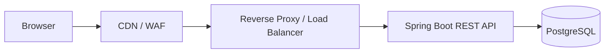

Initially, we will not build a separate gateway microservice.

The reverse proxy or deployment edge layer will handle:

- TLS termination.
- Routing.
- Traffic limits.
- Request-size limits.
- WAF integration.
- Load balancing.

Spring Security and application services will enforce authentication and authorization.

The backend must never assume that a request is safe simply because it passed through the gateway.

## 8.2 API Versioning

All APIs will use:

```text
/api/v1
```

Examples:

```text
/api/v1/auth/login
/api/v1/users/me
/api/v1/organizations
/api/v1/projects
/api/v1/tasks
```

## 8.3 API Standards

- REST conventions.
- Request validation.
- Consistent response formats.
- RFC 9457 problem-detail error responses.
- Pagination.
- API documentation using OpenAPI.
- Authorization on every protected operation.
- Request-size limits.
- Rate limiting.
- Safe error responses.
- Correlation IDs.

---

# 9. HLD — Authentication and Authorization

## 9.1 Authentication

Authentication establishes the identity of the requester.

Initial browser strategy, detailed by [ADR-005](../adr/ADR-005-server-managed-browser-sessions.md):

- Server-managed opaque session stored in PostgreSQL for multi-instance consistency.
- Secure HttpOnly cookie.
- Secure cookie transport.
- Appropriate SameSite policy.
- CSRF protection.
- Session expiration.
- Session revocation.
- Session rotation where appropriate.
- PostgreSQL-backed per-account and per-source login throttling across instances.
- Sliding idle renewal throttled to one database write per configured touch interval and capped by absolute expiry.

ADR-011 records the implemented timeout, rate-limit, CSRF, and cookie defaults. Production telemetry may tighten them through typed environment configuration; weakening them requires security review.

Avoid exposing long-lived credentials to JavaScript.

## 9.2 Authorization

Authorization decides what an authenticated user is allowed to do.

WorkSphere will use:

- RBAC.
- Resource-level authorization.
- Organization membership checks.
- Project-level access checks.
- Business policy checks.

### Authorization Flow

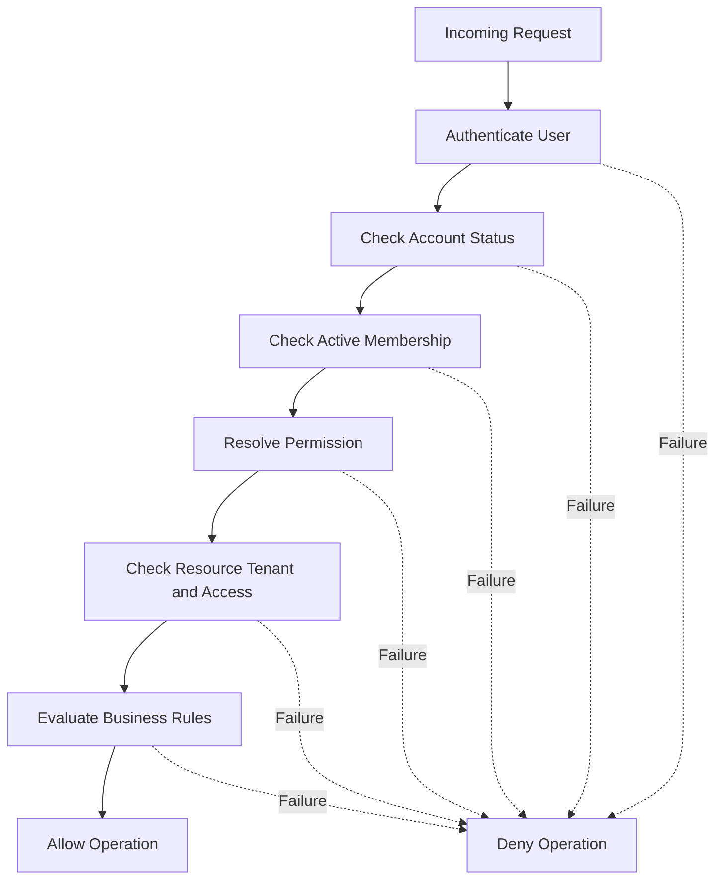

All failed authorization checks must deny access.

A role name alone must never be considered sufficient proof of resource access.

---

# 10. HLD — Multi-Tenant Architecture

## 10.1 Tenant Strategy

Initial strategy:

**Shared PostgreSQL database and shared schema with organization_id tenant ownership.**

Every tenant-owned resource must have an explicit organization association.

Examples:

- Projects.
- Project members.
- Tasks.
- Invitations.
- Organization settings.
- Organization-specific audit events.

Global users can belong to multiple organizations through membership records.

## 10.2 Tenant Isolation Diagram

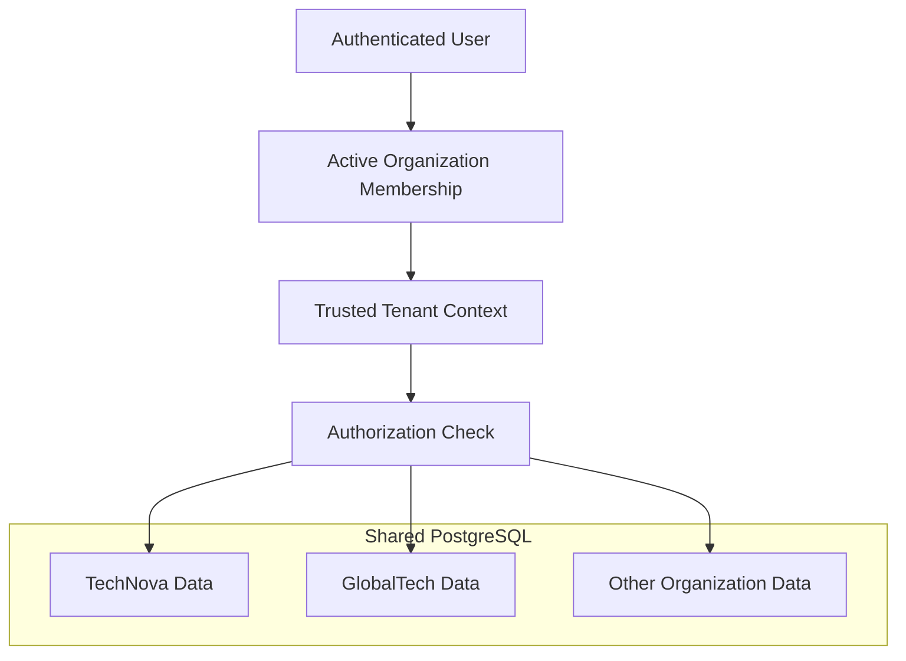

The diagram shows logical data separation, not unrestricted access to all tenant data.

The authorization layer must only select resources that belong to the authenticated user's authorized tenant context.

## 10.3 Tenant Isolation Rules

1. Resolve tenant context on the backend.
2. Validate active membership.
3. Apply tenant predicates in database access.
4. Verify resource ownership.
5. Protect relationships using database constraints.
6. Apply tenant-aware authorization to background operations.
7. Include tenant boundaries in cache keys if caching is introduced.
8. Test cross-tenant access explicitly.

PostgreSQL Row-Level Security may be considered as additional defense in depth.

---

# 11. HLD — Database Architecture

## 11.1 Primary Database

PostgreSQL is the transactional source of truth.

It will store:

- Users.
- Organizations.
- Memberships.
- Roles.
- Permissions.
- Projects.
- Tasks.
- Invitations.
- Sessions.
- Audit events.
- Outbox events.

The outbox is introduced with the first reliable asynchronous verification, reset or invitation email workflow. It is designed, not currently implemented. Comments, teams, general notifications and analytics are deferred.

## 11.2 Logical Database Relationship Diagram

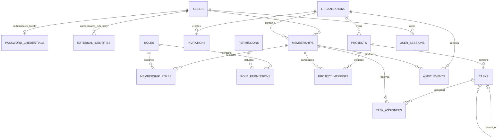

Permissions are global predefined capabilities; roles are organization-owned. The authoritative keys, actor references and physical relationships are in the [database design](../er-diagram/erd.md).

## 11.3 Database Design Principles

- Use UUIDs where appropriate.
- Use foreign keys.
- Use tenant-aware composite relationships where required.
- Use unique constraints.
- Use appropriate indexes.
- Use Flyway.
- Avoid unbounded queries.
- Use pagination.
- Prevent cross-tenant relationships.
- Use transactions.
- Review query plans for important queries.
- Define retention policies.

---

# 12. HLD — Future Infrastructure

These components are intentionally not part of the first implementation.

## 12.1 Redis

Potential responsibilities:

- Caching.
- High-volume edge rate limiting if PostgreSQL-backed authentication throttling becomes insufficient.
- Presence.
- Temporary state.
- Selected coordination operations.

PostgreSQL remains the source of truth.

Redis will only be introduced when measurable requirements justify it.

## 12.2 Kafka

Potential responsibilities:

- Asynchronous event processing.
- Notifications.
- Analytics pipelines.
- External integrations.
- Background processing.

Important patterns:

- Transactional outbox.
- Idempotent consumers.
- Retries.
- Dead-letter queues.
- Event versioning.
- Tenant context propagation.

Kafka will not be introduced in the initial foundation.

## 12.3 WebSockets

Potential responsibilities:

- Live task updates.
- Real-time notifications.
- Presence.
- Collaboration updates.

Requirements:

- Authenticated connections.
- Authorized subscriptions.
- Tenant-aware channels.
- Message validation.
- Connection limits.
- Session expiration handling.

REST APIs will be used initially.

## 12.4 Object Storage

Future file storage should use a dedicated object storage system rather than storing large files directly in PostgreSQL.

The design must cover:

- Upload authorization.
- File size limits.
- File type validation.
- Malware scanning.
- Private storage.
- Tenant isolation.
- Signed download access.
- Retention and deletion.

---

# PART C — LOW-LEVEL DESIGN (LLD)

# 13. LLD Introduction

Low-Level Design defines the internal implementation of individual components.

It answers:

- What classes are needed?
- What interfaces are needed?
- What are the method responsibilities?
- What are the database columns?
- How does a use case execute?
- Where are transactions applied?
- How are errors handled?
- How are security policies implemented?

The following designs are initial implementation blueprints.

Detailed schemas and class contracts must be reviewed before implementation.

---

# 14. LLD — Backend Package Structure

Recommended base package:

```text
com.worksphere
```

Recommended structure:

```text
backend/
└── src/
    └── main/
        ├── java/
        │   └── com/worksphere/
        │
        │       ├── WorkSphereApplication.java
        │
        │       ├── shared/
        │       │   ├── configuration/
        │       │   ├── exception/
        │       │   ├── security/
        │       │   ├── logging/
        │       │   └── web/
        │
        │       ├── identity/
        │       │   ├── domain/
        │       │   │   ├── model/
        │       │   │   ├── valueobject/
        │       │   │   ├── service/
        │       │   │   └── exception/
        │       │   ├── application/
        │       │   │   ├── usecase/
        │       │   │   ├── port/in/
        │       │   │   ├── port/out/
        │       │   │   └── service/
        │       │   ├── infrastructure/
        │       │   │   ├── persistence/
        │       │   │   ├── security/
        │       │   │   └── configuration/
        │       │   └── presentation/
        │       │       └── rest/
        │       │           ├── controller/
        │       │           ├── request/
        │       │           └── response/
        │       │
        │       ├── organization/
        │       ├── authorization/
        │       ├── project/
        │       ├── task/
        │       └── audit/
        │
        └── resources/
            ├── application.yml
            ├── application-local.yml
            ├── application-test.yml
            └── db/migration/
```

## 14.1 Naming Conventions

Examples:

| Component | Naming |
|---|---|
| Domain entity | User |
| Value object | EmailAddress |
| Use case | RegisterUserUseCase |
| Input port | RegisterUser |
| Output port | UserRepository |
| Persistence adapter | JpaUserRepositoryAdapter |
| JPA entity | UserJpaEntity |
| REST controller | AuthenticationController |
| Request DTO | RegisterUserRequest |
| Response DTO | UserResponse |
| Domain exception | UserAlreadyExistsException |

Do not expose persistence entities directly from controllers.

---

# 15. LLD — Identity Module

## 15.1 Responsibilities

The Identity module manages:

- User identity.
- Credentials.
- Account status.
- Email verification.
- Password recovery.
- Session lifecycle.
- Authentication-related events.

## 15.2 Main Domain Objects

### User

Conceptual fields:

```text
User
----
id: UUID
email: EmailAddress
passwordHash: PasswordHash
firstName: String
lastName: String
status: UserStatus
emailVerifiedAt: Instant
createdAt: Instant
updatedAt: Instant
```

### UserStatus

Possible values:

```text
PENDING_VERIFICATION
ACTIVE
LOCKED
SUSPENDED
DEACTIVATED
```

Exact state transitions must be defined and validated.

### UserSession

Conceptual fields:

```text
UserSession
-----------
id: UUID
userId: UUID
sessionTokenHash: String
createdAt: Instant
expiresAt: Instant
lastAccessedAt: Instant
revokedAt: Instant
deviceInformation: String
```

The raw session identifier must not be stored or logged.

## 15.3 Identity Interfaces

Example input ports:

```java
public interface RegisterUserUseCase {
    UserId register(RegisterUserCommand command);
}
```

```java
public interface AuthenticateUserUseCase {
    AuthenticatedSession authenticate(
        AuthenticateUserCommand command
    );
}
```

Example output ports:

```java
public interface UserRepository {
    Optional<User> findByEmail(EmailAddress email);

    User save(User user);
}
```

```java
public interface PasswordHasher {
    PasswordHash hash(String rawPassword);

    boolean matches(
        String rawPassword,
        PasswordHash passwordHash
    );
}
```

These are conceptual contracts. Exact return types, error handling, and secret-handling practices must be refined before implementation.

## 15.4 Registration Flow

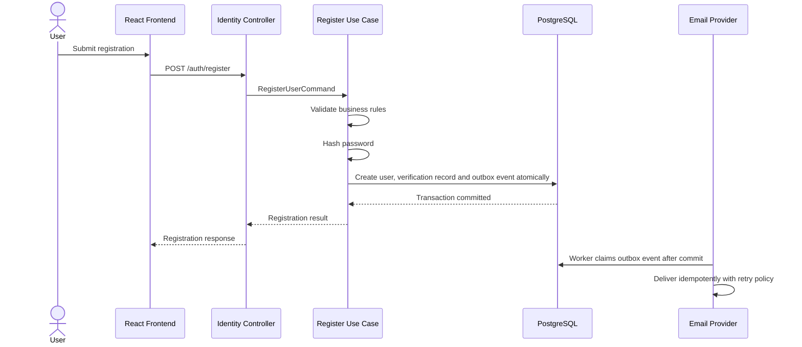

Email delivery does not determine whether the user transaction commits. The outbox is introduced with this first reliable workflow as specified by [ADR-008](../adr/ADR-008-transactional-outbox-strategy.md); this is a design, not a claim of implementation.

## 15.5 Login Flow

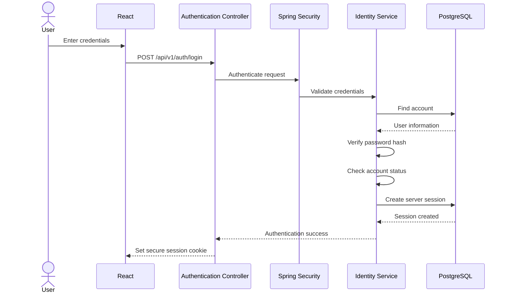

The final implementation must include abuse protection, appropriate failure handling, session fixation protection, and security event recording.

## 15.6 Password Reset Flow

1. User requests password reset.
2. Backend returns a response that does not reveal whether an account exists.
3. Backend generates a secure random token.
4. Only a protected representation of the token is stored.
5. Token has an expiration time and single-use semantics.
6. Email provider delivers the reset link.
7. User submits a new password.
8. Backend verifies token and expiration.
9. Backend updates the password hash transactionally.
10. Existing sessions are revoked according to the security policy.
11. Audit event is recorded.

---

# 16. LLD — Organization Module

## 16.1 Main Domain Objects

### Organization

```text
Organization
------------
id: UUID
name: String
slug: String
status: OrganizationStatus
createdAt: Instant
updatedAt: Instant
```

### Membership

```text
Membership
----------
id: UUID
organizationId: UUID
userId: UUID
status: MembershipStatus
joinedAt: Instant
createdAt: Instant
```

### Invitation

```text
Invitation
----------
id: UUID
organizationId: UUID
email: EmailAddress
tokenHash: String
status: InvitationStatus
expiresAt: Instant
invitedByMembershipId: UUID
acceptedAt: Instant
createdAt: Instant
```

## 16.2 Organization Creation

The following operations should be committed as one database transaction:

1. Validate organization creation request.
2. Validate the authenticated user.
3. Create organization.
4. Create initial membership.
5. Assign owner role.
6. Record audit event.
7. Commit transaction.

If a required operation fails, the transaction must roll back.

## 16.3 Invitation Workflow

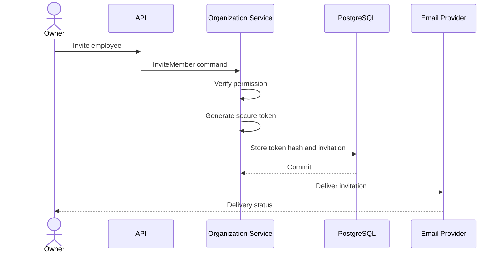

Invitation acceptance must verify:

- Token validity.
- Token expiration.
- Invitation status.
- Email/account matching policy.
- Organization status.
- Membership duplication rules.

---

# 17. LLD — Authorization Module

## 17.1 Main Database Objects

```text
roles
-----
id
organization_id
name
description
is_system_role
created_at

permissions
-----------
id
code
description

role_permissions
----------------
role_id
permission_id

membership_roles
----------------
membership_id
role_id
```

System-level roles and organization-specific roles must have clearly separated ownership and administration rules.

## 17.2 Permission Examples

```text
ORGANIZATION_VIEW
ORGANIZATION_UPDATE
MEMBER_INVITE
MEMBER_REMOVE
ROLE_ASSIGN
ROLE_UPDATE

PROJECT_CREATE
PROJECT_VIEW
PROJECT_UPDATE
PROJECT_ARCHIVE
PROJECT_MEMBER_ADD

TASK_CREATE
TASK_VIEW
TASK_UPDATE
TASK_ASSIGN
TASK_DELETE
```

Comment permissions are added with the deferred comments capability.

## 17.3 Authorization Service

Conceptual interface:

```java
public interface AuthorizationService {

    void requirePermission(
        MembershipId membershipId,
        PermissionCode permission
    );

    void requireProjectAccess(
        MembershipId membershipId,
        ProjectId projectId
    );

    void requireTaskAccess(
        MembershipId membershipId,
        TaskId taskId
    );
}
```

These checks must use trusted server-side identity and tenant context.

## 17.4 Authorization Decision

A protected operation must evaluate:

1. Authenticated identity.
2. Account status.
3. Active organization membership.
4. Effective permissions.
5. Resource tenant ownership.
6. Resource-specific access.
7. Business restrictions.

The system must deny by default.

Do not depend solely on frontend route protection or button visibility.

---

# 18. LLD — Project Module

## 18.1 Project Domain Object

```text
Project
-------
id: UUID
organizationId: UUID
name: String
description: String
status: ProjectStatus
priority: ProjectPriority
startDate: LocalDate
dueDate: LocalDate
createdByMembershipId: UUID
createdAt: Instant
updatedAt: Instant
```

## 18.2 Project Member

```text
ProjectMember
-------------
id: UUID
organizationId: UUID
projectId: UUID
membershipId: UUID
projectRole: ProjectRole
joinedAt: Instant
```

## 18.3 Project Use Cases

- CreateProjectUseCase
- UpdateProjectUseCase
- ArchiveProjectUseCase
- AddProjectMemberUseCase
- RemoveProjectMemberUseCase
- GetProjectUseCase
- ListProjectsUseCase

## 18.4 Create Project Flow

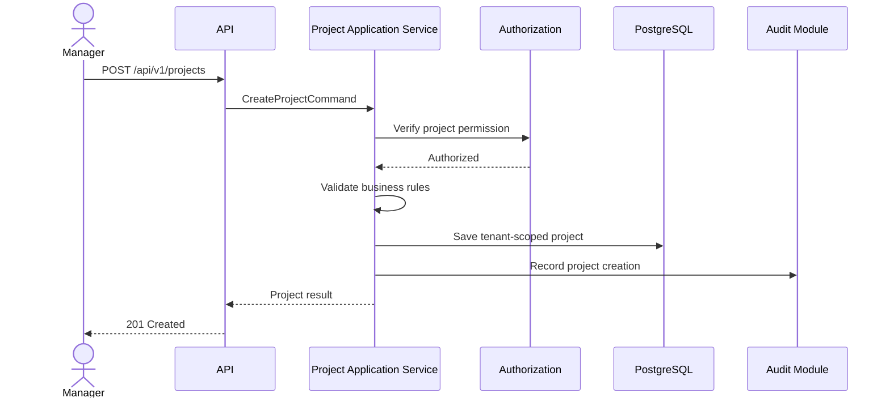

Project creation and its required audit record should be transactionally consistent where they are stored in the same database.

---

# 19. LLD — Task Module

## 19.1 Task Domain Object

```text
Task
----
id: UUID
organizationId: UUID
projectId: UUID
title: String
description: String
status: TaskStatus
priority: TaskPriority
assigneeMembershipId: UUID
createdByMembershipId: UUID
dueDate: Instant
createdAt: Instant
updatedAt: Instant
version: Long
```

The version field can support optimistic locking where concurrent updates are possible.

## 19.2 Task Status

Initial values:

```text
TODO
IN_PROGRESS
IN_REVIEW
COMPLETED
CANCELLED
```

Allowed transitions must be defined by business rules.

For example:

```text
TODO -> IN_PROGRESS
IN_PROGRESS -> IN_REVIEW
IN_REVIEW -> COMPLETED
IN_REVIEW -> IN_PROGRESS
TODO -> CANCELLED
```

Do not assume every status transition is valid.

## 19.3 Task Assignment Rules

Before assigning a task:

1. Verify the requester.
2. Verify organization membership.
3. Verify project access.
4. Verify task assignment permission.
5. Verify the assignee belongs to the same organization.
6. Verify project membership if required by project policy.
7. Update task.
8. Record history and audit event.

## 19.4 Task Assignment Flow

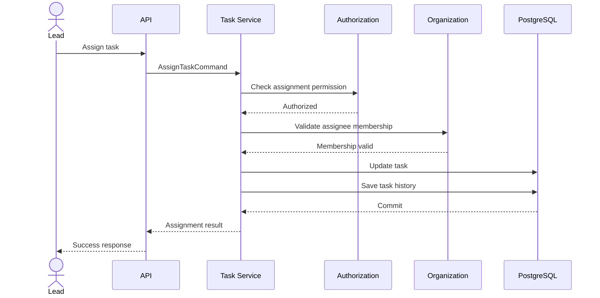

Task update, task history and required outbox records should be handled transactionally where applicable.

---

# 20. LLD — REST API Design

## 20.1 Authentication APIs

| Method | Endpoint | Responsibility |
|---|---|---|
| POST | /api/v1/auth/register | Register user |
| POST | /api/v1/auth/login | Authenticate user |
| POST | /api/v1/auth/logout | Terminate session |
| GET | /api/v1/users/me | Current user profile |
| POST | /api/v1/auth/verify-email | Verify email |
| POST | /api/v1/auth/forgot-password | Request reset |
| POST | /api/v1/auth/reset-password | Reset password |

## 20.2 Organization APIs

| Method | Endpoint | Responsibility |
|---|---|---|
| POST | /api/v1/organizations | Create organization |
| GET | /api/v1/organizations | List accessible organizations |
| GET | /api/v1/organizations/{id} | Organization details |
| PATCH | /api/v1/organizations/{id} | Update organization |
| POST | /api/v1/organizations/{id}/invitations | Invite member |
| GET | /api/v1/organizations/{id}/members | List members |
| DELETE | /api/v1/organizations/{id}/members/{memberId} | Remove member |

## 20.3 Project APIs

| Method | Endpoint | Responsibility |
|---|---|---|
| POST | /api/v1/projects | Create project |
| GET | /api/v1/projects | List projects |
| GET | /api/v1/projects/{id} | Project details |
| PATCH | /api/v1/projects/{id} | Update project |
| POST | /api/v1/projects/{id}/members | Add project member |
| DELETE | /api/v1/projects/{id}/members/{memberId} | Remove project member |

## 20.4 Task APIs

| Method | Endpoint | Responsibility |
|---|---|---|
| POST | /api/v1/projects/{id}/tasks | Create task |
| GET | /api/v1/projects/{id}/tasks | List tasks |
| GET | /api/v1/tasks/{id} | Task details |
| PATCH | /api/v1/tasks/{id} | Update task |
| GET | /api/v1/tasks/{id}/history | Task history |

All endpoints must implement the applicable authentication, authorization, validation, tenant isolation and audit rules.

---

# 21. LLD — Database Schema Design Baseline

The authoritative logical and physical baseline is [the database design and ERD](../er-diagram/erd.md). It defines normalized identity keys, lifecycle fields, global permissions, organization roles, tenant-owned membership actors, composite foreign keys, multi-assignee tasks, same-project parent-task integrity, audit controls, outbox behavior, delete rules and index candidates.

Flyway V1 implements the identity foundation: users, optional password credentials, external identities, opaque sessions, verification/reset tokens, and OAuth authorization transactions. V2 adds shared login-rate-limit state. SQL examples are intentionally not duplicated here so the system design cannot drift from the physical baseline. Remaining domain migrations will be created incrementally after review and tested with PostgreSQL Testcontainers.

---

# 22. LLD — Transaction Management

Database transactions are essential for business consistency.

Examples:

### Organization Creation

One transaction should cover:

- Organization creation.
- Owner membership creation.
- Owner role assignment.
- Required audit record.

### Task Assignment

One transaction should cover:

- Task assignment.
- Task history.
- Required outbox record.

### Invitation Acceptance

One transaction should cover:

- Invitation validation.
- Invitation consumption.
- Membership creation or activation.
- Required audit event.

External email delivery must not be performed as an unbounded synchronous operation inside a database transaction.

Use an appropriate reliable asynchronous delivery strategy.

---

# 23. LLD — Error Handling

Use centralized exception handling.

Recommended exception categories:

```text
ValidationException
AuthenticationException
AuthorizationException
ResourceNotFoundException
ConflictException
BusinessRuleViolationException
ExternalServiceException
```

Use consistent HTTP responses.

| Condition | HTTP status |
|---|---|
| Successful retrieval | 200 |
| Successful creation | 201 |
| Successful deletion without body | 204 |
| Invalid request | 400 |
| Unauthenticated | 401 |
| Authenticated but unauthorized | 403 |
| Resource unavailable or not found | 404 |
| Business conflict | 409 |
| Rate limit exceeded | 429 |
| Unexpected internal error | 500 |
| Dependency unavailable | 503 |

For sensitive tenant-owned resources, a not-found response may be preferable to avoid disclosing the existence of resources belonging to another organization.

Never return raw exception messages or database errors to clients.

---

# 24. LLD — Audit Architecture

## 24.1 Audit Event Structure

Conceptual fields:

```text
AuditEvent
----------
id: UUID
organizationId: UUID
actorUserId: UUID
actorMembershipId: UUID
action: String
resourceType: String
resourceId: UUID
occurredAt: Instant
correlationId: String
metadata: JSONB
```

Metadata must be carefully restricted.

Do not store:

- Passwords.
- Session cookies.
- Raw tokens.
- Authentication secrets.
- Unnecessary sensitive personal information.

## 24.2 Audit Flow

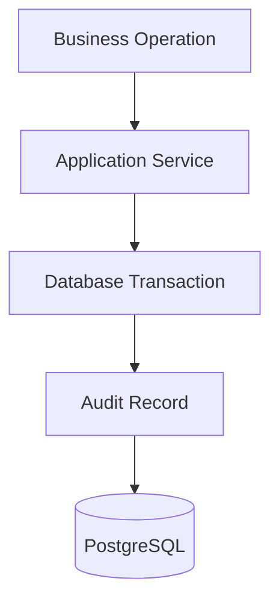

For critical operations, audit recording should be transactionally consistent with the business operation.

Audit records should have restricted update/delete permissions and appropriate retention policies.

---

# 25. LLD — Notification Architecture

Release 1 does not include a general notification product. Verification, password-reset and invitation email use an application-managed outbox worker. General in-app notifications and preferences are deferred.

Responsibilities:

- Notification creation.
- Notification preferences.
- Email delivery.
- Retry management.
- Delivery status.
- Read/unread status.

Example flow:

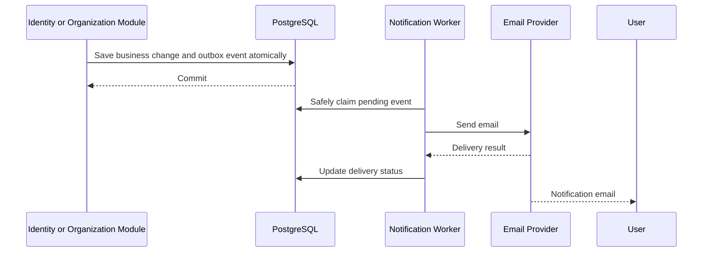

Delivery must support retries, idempotency, monitoring and failure handling.

Successful events are retained provisionally for 30 days and failed events for 90 days. Exhausted failures enter a terminal state, alert operators and permit controlled replay. Raw one-time invitation, reset and verification secrets are never placed in general event metadata or logs.

Kafka may replace or extend the internal delivery mechanism in a later milestone.

---

# 26. LLD — Frontend Component Design

Recommended feature structure:

```text
frontend/src/
│
├── app/
│   ├── router/
│   ├── providers/
│   ├── layouts/
│   └── configuration/
│
├── modules/
│   ├── auth/
│   │   ├── api/
│   │   ├── components/
│   │   ├── hooks/
│   │   ├── pages/
│   │   └── schemas/
│   │
│   ├── organization/
│   ├── members/
│   ├── projects/
│   └── tasks/
│
├── shared/
│   ├── components/
│   ├── hooks/
│   ├── api/
│   ├── utilities/
│   └── types/
│
└── tests/
```

Deferred collaboration, general notification and analytics features add modules only when their milestone begins; empty placeholder modules are not created in Release 1.

## 26.1 Example Frontend Components

Authentication:

- LoginPage
- RegisterPage
- ForgotPasswordPage
- ResetPasswordPage
- VerifyEmailPage

Organization:

- OrganizationDashboard
- OrganizationSettings
- MembersPage
- InviteMemberDialog
- RolesPage

Projects:

- ProjectListPage
- ProjectDetailsPage
- CreateProjectDialog
- ProjectMembers
- ProjectOverview

Tasks:

- TaskListPage
- TaskDetailsPage
- TaskBoard
- CreateTaskDialog
- AssignTaskDialog

Task comments are added in the deferred collaboration milestone.

## 26.2 Frontend Engineering Rules

- Reuse shared UI components.
- Keep feature code inside feature modules.
- Use centralized API communication.
- Use strict TypeScript.
- Validate forms.
- Avoid duplicating server-state logic.
- Handle loading and errors.
- Protect sensitive cached data.
- Never treat frontend permission checks as backend authorization.

---

# PART D — SECURITY AND OPERATIONAL DESIGN

# 27. Security Threat Model

WorkSphere must consider the following threats.

| Threat | Example | Mitigation |
|---|---|---|
| Broken access control | Employee reads another organization's task | Tenant and resource authorization |
| Credential stuffing | Attackers attempt leaked passwords | Rate limits, MFA and abuse detection |
| Session theft | Attacker obtains session identifier | Secure cookies, TLS and session revocation |
| CSRF | Malicious website submits state-changing requests | CSRF protection and SameSite controls |
| XSS | Malicious content executes in browser | Safe rendering and output handling |
| SQL injection | Malicious query input | Parameterized database operations |
| IDOR | User changes resource UUID | Backend ownership and permission checks |
| Privilege escalation | User assigns themselves admin | Restricted role administration |
| Malicious upload | Executable file disguised as document | Validation, scanning and private storage |
| Event duplication | Notification is delivered twice | Idempotent processing |
| Tenant cache leakage | Shared cache key returns wrong organization data | Tenant-aware cache design |
| Insider misuse | Administrator accesses customer data | Least privilege and audited support access |

Threat modelling must be updated as the system evolves.

---

# 28. Operational Design

## 28.1 Configuration

Separate:

- Local configuration.
- Test configuration.
- Staging configuration.
- Production configuration.

Secrets must be supplied securely through environment-specific secret management.

Do not commit passwords, API keys, signing keys, session secrets or database credentials.

## 28.2 Health Checks

Use Spring Boot Actuator.

Expose only required health information.

Examples:

```text
/actuator/health
/actuator/health/liveness
/actuator/health/readiness
```

Access to operational endpoints must be restricted appropriately.

## 28.3 Observability

Initial and future monitoring:

- Structured logs.
- Correlation IDs.
- Request metrics.
- JVM metrics.
- Database metrics.
- Error rates.
- Latency.
- Tracing.
- Operational alerts.

Potential technology choices include Micrometer, OpenTelemetry, Prometheus and Grafana.

## 28.4 Backup and Recovery

Production operations must include:

- Automated backups.
- Point-in-time recovery where supported.
- Backup encryption.
- Restricted backup access.
- Restore procedures.
- Recovery exercises.
- Documented RPO and RTO.

A backup is not considered verified until restoration has been tested.

---

# 29. Deployment Design

## 29.1 Local Deployment

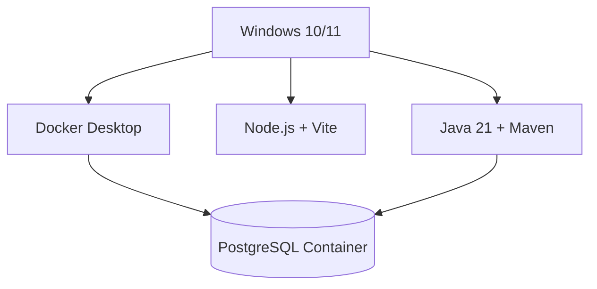

The backend and frontend initially run on the developer machine.

PostgreSQL runs in Docker Compose.

## 29.2 Production Deployment

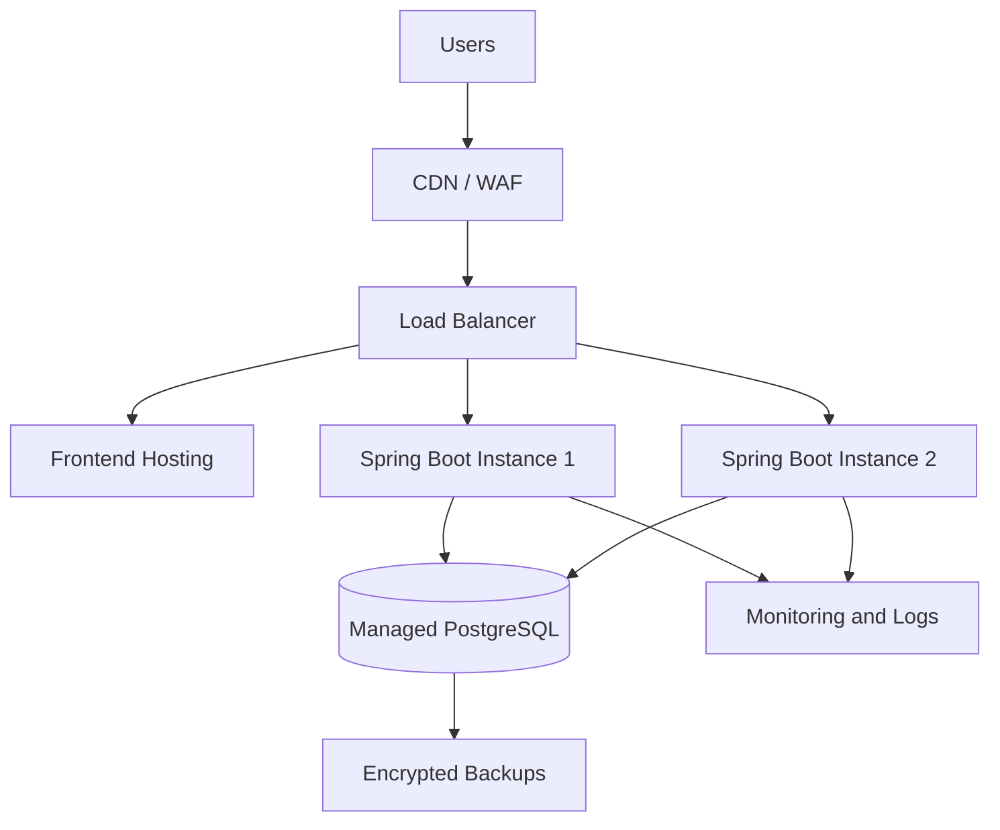

This is a target deployment topology, not an assertion that all components must exist in the first release.

Database high availability, load balancing, connection pooling, network access and failover must be configured and tested in the selected hosting environment.

---

# PART E — IMPLEMENTATION AND DESIGN GATES

# 30. Development Milestones

| Milestone | Design/Implementation Focus |
|---|---|
| M0 | Engineering governance and architecture documentation |
| M1 | Windows development setup and project foundation |
| M2 | Approve ADRs/ERD, then create incremental migrations and module boundaries |
| M3 | Identity and authentication |
| M4 | Authorization and multi-tenancy |
| M5 | Project management |
| M6 | Task management |
| M7 | React frontend integration |
| M8 | Deferred collaboration and general notifications |
| M9 | Security hardening |
| M10 | Performance testing |
| M11 | Production deployment and operations |
| M12 | Enterprise features |

# 31. Mandatory Design Review Gates

Before implementation of a major module, review:

### Database Gate

- ERD approved.
- Columns and types approved.
- PK/FK relationships approved.
- Tenant constraints approved.
- Unique constraints approved.
- Indexes reviewed.
- Migrations reviewed.

### Security Gate

- Authentication flow approved.
- Authorization rules approved.
- Tenant ownership rules approved.
- Abuse scenarios considered.
- Error handling reviewed.
- Security tests identified.

### API Gate

- Endpoints approved.
- Request DTOs approved.
- Response DTOs approved.
- Validation rules approved.
- Authorization requirements documented.
- Status codes documented.

### Implementation Gate

- Architecture followed.
- Tests pass.
- Security tests pass where applicable.
- Database migrations verified.
- Documentation updated.
- Changes reviewed.
- Milestone completion report produced.

# 32. Proposed Architecture Baseline

The following decisions form the review baseline. They remain Proposed until humans approve the ADRs; this document does not mark them Accepted:

1. Java 21 and Spring Boot for backend development.
2. React and TypeScript for frontend development.
3. PostgreSQL as the primary transactional database.
4. Flyway for schema migration.
5. Modular monolith as the initial deployment architecture.
6. Clean Architecture and controlled DDD boundaries.
7. Shared database and shared schema for initial multi-tenancy.
8. Backend-enforced authentication and authorization.
9. RBAC combined with resource-level authorization.
10. Server-managed opaque browser sessions stored in PostgreSQL, with policy values finalized before implementation.
11. Docker Compose for local infrastructure.
12. Redis, Kafka and WebSockets deferred until justified.
13. Dedicated API Gateway deferred until justified.
14. Production observability, backups and recovery required before production launch.

---

# 33. Final System Design Principle

WorkSphere must be engineered as a system where security, business correctness, reliability and maintainability are designed into the foundation.

The initial system must be simple enough to develop and operate, but structured enough to support future enterprise growth.

The most important design priorities are:

- Strong identity and authentication.
- Reliable authorization.
- Complete tenant isolation.
- Correct database relationships.
- Clear business module boundaries.
- Consistent API contracts.
- Testable business logic.
- Secure operational practices.
- Measured performance.
- Controlled infrastructure evolution.

**WorkSphere — One Workspace. Connected Teams. Better Work.**
