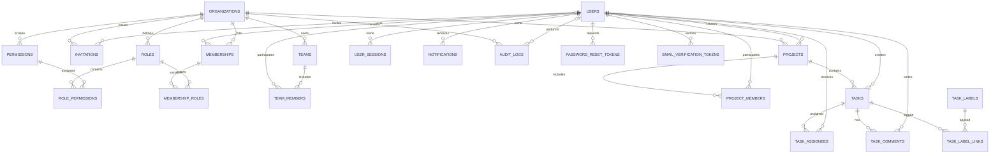

# WorkSphere – Database Design
## Entity Relationship Diagram (ERD) and Physical Data Model

**Version:** 1.0  
**Database:** PostgreSQL  
**Architecture:** Modular Monolith  
**Multi-tenancy:** Shared database, shared schema  
**Backend:** Java 21 + Spring Boot + Spring Data JPA  
**Migration strategy:** Flyway

---

# 1. Database Design Principles

The database must support:

- Multiple independent organizations.
- Users who may belong to multiple organizations.
- Organization-specific roles and permissions.
- Projects, project membership, tasks, assignments and comments.
- Invitations and organization onboarding.
- In-app and email notifications.
- Security and business audit history.
- Future scalability without prematurely introducing unnecessary infrastructure.

### Important rules

1. Use UUID primary keys for business entities.
2. Use `organization_id` on organization-owned records.
3. Enforce tenant consistency in database relationships using composite foreign keys where applicable.
4. Never rely on frontend filtering for tenant security.
5. Store timestamps in `TIMESTAMPTZ` using UTC.
6. Store passwords using Argon2id hashes, never plaintext.
7. Store only hashed authentication, invitation and password-reset tokens.
8. Use Flyway for all schema changes.
9. Do not use Hibernate `ddl-auto=update` in production.
10. Use explicit constraints, indexes and unique rules.

---

# 2. High-Level ERD

The following diagram shows the main entities and their relationships.



This is the logical overview. The detailed table definitions below establish the intended keys, constraints and tenant boundaries.

---

# 3. Identity and Authentication Tables

## 3.1 `users`

Stores global user identities.

| Column | Type | Constraints |
|---|---|---|
| id | UUID | PK |
| email | VARCHAR(320) | NOT NULL |
| normalized_email | VARCHAR(320) | NOT NULL, UNIQUE |
| password_hash | VARCHAR(255) | NOT NULL |
| first_name | VARCHAR(100) | NOT NULL |
| last_name | VARCHAR(100) | NOT NULL |
| display_name | VARCHAR(200) | NULL |
| status | VARCHAR(30) | NOT NULL |
| email_verified_at | TIMESTAMPTZ | NULL |
| last_login_at | TIMESTAMPTZ | NULL |
| created_at | TIMESTAMPTZ | NOT NULL |
| updated_at | TIMESTAMPTZ | NOT NULL |
| version | BIGINT | NOT NULL |

**Notes:**
- A user is a global identity, not an organization-specific identity.
- A user can belong to multiple organizations.
- `normalized_email` is generated consistently by application logic and uniquely constrained.
- Suggested statuses: `PENDING_VERIFICATION`, `ACTIVE`, `LOCKED`, `DISABLED`.
- Do not store a user's organization role directly in this table.

## 3.2 `user_sessions`

Stores server-managed login sessions.

| Column | Type | Constraints |
|---|---|---|
| id | UUID | PK |
| user_id | UUID | FK → users.id |
| token_hash | VARCHAR(255) | NOT NULL, UNIQUE |
| created_at | TIMESTAMPTZ | NOT NULL |
| expires_at | TIMESTAMPTZ | NOT NULL |
| last_seen_at | TIMESTAMPTZ | NULL |
| revoked_at | TIMESTAMPTZ | NULL |
| ip_address | INET | NULL |
| user_agent | TEXT | NULL |

The browser receives a secure session cookie. The raw session secret must not be stored in this table.

## 3.3 `password_reset_tokens`

| Column | Type | Constraints |
|---|---|---|
| id | UUID | PK |
| user_id | UUID | FK → users.id |
| token_hash | VARCHAR(255) | NOT NULL, UNIQUE |
| expires_at | TIMESTAMPTZ | NOT NULL |
| used_at | TIMESTAMPTZ | NULL |
| created_at | TIMESTAMPTZ | NOT NULL |

## 3.4 `email_verification_tokens`

| Column | Type | Constraints |
|---|---|---|
| id | UUID | PK |
| user_id | UUID | FK → users.id |
| token_hash | VARCHAR(255) | NOT NULL, UNIQUE |
| expires_at | TIMESTAMPTZ | NOT NULL |
| used_at | TIMESTAMPTZ | NULL |
| created_at | TIMESTAMPTZ | NOT NULL |

---

# 4. Organization and Multi-Tenancy Tables

## 4.1 `organizations`

Represents a customer organization or tenant.

| Column | Type | Constraints |
|---|---|---|
| id | UUID | PK |
| name | VARCHAR(200) | NOT NULL |
| slug | VARCHAR(100) | NOT NULL |
| status | VARCHAR(30) | NOT NULL |
| timezone | VARCHAR(100) | NOT NULL |
| created_at | TIMESTAMPTZ | NOT NULL |
| updated_at | TIMESTAMPTZ | NOT NULL |
| version | BIGINT | NOT NULL |

Unique constraint: `UNIQUE(slug)` for the initial globally unique organization slug policy.

Suggested statuses: `ACTIVE`, `SUSPENDED`, `CLOSED`.

## 4.2 `memberships`

Connects users to organizations.

| Column | Type | Constraints |
|---|---|---|
| id | UUID | PK |
| organization_id | UUID | FK → organizations.id |
| user_id | UUID | FK → users.id |
| status | VARCHAR(30) | NOT NULL |
| joined_at | TIMESTAMPTZ | NULL |
| created_at | TIMESTAMPTZ | NOT NULL |
| updated_at | TIMESTAMPTZ | NOT NULL |

Constraints:

- `UNIQUE(organization_id, user_id)`
- `UNIQUE(id, organization_id)` for tenant-aware composite references.

Suggested statuses: `INVITED`, `ACTIVE`, `SUSPENDED`, `REMOVED`.

A user may have one membership in several different organizations, but only one membership per organization.

## 4.3 `invitations`

| Column | Type | Constraints |
|---|---|---|
| id | UUID | PK |
| organization_id | UUID | FK → organizations.id |
| invited_by_user_id | UUID | FK → users.id |
| email | VARCHAR(320) | NOT NULL |
| normalized_email | VARCHAR(320) | NOT NULL |
| token_hash | VARCHAR(255) | NOT NULL, UNIQUE |
| status | VARCHAR(30) | NOT NULL |
| expires_at | TIMESTAMPTZ | NOT NULL |
| accepted_at | TIMESTAMPTZ | NULL |
| created_at | TIMESTAMPTZ | NOT NULL |

An invitation belongs to exactly one organization. Its token must be random, single-use, expiring and stored only as a hash.

---

# 5. Role-Based Access Control (RBAC)

Roles and permissions are organization-scoped.

## 5.1 `roles`

| Column | Type | Constraints |
|---|---|---|
| id | UUID | PK |
| organization_id | UUID | FK → organizations.id |
| name | VARCHAR(100) | NOT NULL |
| description | TEXT | NULL |
| is_system_role | BOOLEAN | NOT NULL |
| created_at | TIMESTAMPTZ | NOT NULL |

Constraint: `UNIQUE(id, organization_id)` and `UNIQUE(organization_id, name)`.

Examples:
- Organization Owner
- Organization Admin
- Manager
- Team Lead
- Employee
- Auditor

## 5.2 `permissions`

| Column | Type | Constraints |
|---|---|---|
| id | UUID | PK |
| code | VARCHAR(150) | NOT NULL, UNIQUE |
| description | TEXT | NULL |

Example permission codes:

- `organization.read`
- `organization.update`
- `member.invite`
- `member.remove`
- `role.manage`
- `project.create`
- `project.read`
- `project.update`
- `project.delete`
- `task.create`
- `task.assign`
- `task.update`
- `task.delete`
- `audit.read`

Permissions are application-defined capabilities. They are not a substitute for resource-level authorization.

## 5.3 `role_permissions`

| Column | Type | Constraints |
|---|---|---|
| role_id | UUID | PK, FK → roles.id |
| permission_id | UUID | PK, FK → permissions.id |
| organization_id | UUID | NOT NULL |

Use composite foreign keys to ensure that the role and permission belong to the same organization if permissions are organization-scoped. For the initial design, permissions are global definitions, so `permission_id` references the global permission catalogue and only the role needs tenant ownership.

## 5.4 `membership_roles`

| Column | Type | Constraints |
|---|---|---|
| membership_id | UUID | PK component |
| organization_id | UUID | PK component |
| role_id | UUID | PK component |

Constraints:
- Primary key: `(membership_id, role_id)`.
- Composite FK `(membership_id, organization_id)` → `memberships(id, organization_id)`.
- Composite FK `(role_id, organization_id)` → `roles(id, organization_id)`.

This prevents assigning a role from one organization to a membership in another organization.

---

# 6. Teams

## 6.1 `teams`

| Column | Type | Constraints |
|---|---|---|
| id | UUID | PK |
| organization_id | UUID | FK → organizations.id |
| name | VARCHAR(150) | NOT NULL |
| description | TEXT | NULL |
| created_by_user_id | UUID | FK → users.id |
| created_at | TIMESTAMPTZ | NOT NULL |
| updated_at | TIMESTAMPTZ | NOT NULL |

Constraint: `UNIQUE(id, organization_id)` and `UNIQUE(organization_id, name)`.

## 6.2 `team_members`

| Column | Type | Constraints |
|---|---|---|
| organization_id | UUID | PK component |
| team_id | UUID | PK component |
| membership_id | UUID | PK component |
| joined_at | TIMESTAMPTZ | NOT NULL |

Use composite FKs:
- `(team_id, organization_id)` → `teams(id, organization_id)`.
- `(membership_id, organization_id)` → `memberships(id, organization_id)`.

This ensures a team can only include memberships from its own organization.

---

# 7. Project Management Tables

## 7.1 `projects`

| Column | Type | Constraints |
|---|---|---|
| id | UUID | PK |
| organization_id | UUID | FK → organizations.id |
| name | VARCHAR(200) | NOT NULL |
| description | TEXT | NULL |
| status | VARCHAR(30) | NOT NULL |
| priority | VARCHAR(30) | NOT NULL |
| start_date | DATE | NULL |
| due_date | DATE | NULL |
| created_by_user_id | UUID | FK → users.id |
| created_at | TIMESTAMPTZ | NOT NULL |
| updated_at | TIMESTAMPTZ | NOT NULL |
| archived_at | TIMESTAMPTZ | NULL |
| version | BIGINT | NOT NULL |

Constraints:
- `UNIQUE(id, organization_id)`.
- `CHECK(due_date IS NULL OR start_date IS NULL OR due_date >= start_date)`.

Suggested statuses: `PLANNED`, `ACTIVE`, `ON_HOLD`, `COMPLETED`, `CANCELLED`.

Suggested priorities: `LOW`, `MEDIUM`, `HIGH`, `URGENT`.

## 7.2 `project_members`

| Column | Type | Constraints |
|---|---|---|
| organization_id | UUID | PK component |
| project_id | UUID | PK component |
| membership_id | UUID | PK component |
| project_role | VARCHAR(30) | NOT NULL |
| added_at | TIMESTAMPTZ | NOT NULL |

Composite FKs ensure that both the project and membership belong to the same organization.

## 7.3 `project_status_history`

| Column | Type | Constraints |
|---|---|---|
| id | UUID | PK |
| organization_id | UUID | NOT NULL |
| project_id | UUID | NOT NULL |
| changed_by_user_id | UUID | FK → users.id |
| old_status | VARCHAR(30) | NULL |
| new_status | VARCHAR(30) | NOT NULL |
| changed_at | TIMESTAMPTZ | NOT NULL |

Use `(project_id, organization_id)` as a composite FK to `projects(id, organization_id)`.

---

# 8. Task Management Tables

## 8.1 `tasks`

| Column | Type | Constraints |
|---|---|---|
| id | UUID | PK |
| organization_id | UUID | FK → organizations.id |
| project_id | UUID | NOT NULL |
| parent_task_id | UUID | NULL |
| title | VARCHAR(250) | NOT NULL |
| description | TEXT | NULL |
| status | VARCHAR(30) | NOT NULL |
| priority | VARCHAR(30) | NOT NULL |
| due_at | TIMESTAMPTZ | NULL |
| created_by_user_id | UUID | FK → users.id |
| created_at | TIMESTAMPTZ | NOT NULL |
| updated_at | TIMESTAMPTZ | NOT NULL |
| completed_at | TIMESTAMPTZ | NULL |
| version | BIGINT | NOT NULL |

Constraints:
- `UNIQUE(id, organization_id)`.
- Composite FK `(project_id, organization_id)` → `projects(id, organization_id)`.
- Parent task must belong to the same organization and project.
- `CHECK(parent_task_id IS NULL OR parent_task_id <> id)`.

Suggested statuses: `TODO`, `IN_PROGRESS`, `IN_REVIEW`, `BLOCKED`, `DONE`, `CANCELLED`.

## 8.2 `task_assignees`

Supports multiple assignees per task.

| Column | Type | Constraints |
|---|---|---|
| organization_id | UUID | PK component |
| task_id | UUID | PK component |
| membership_id | UUID | PK component |
| assigned_by_user_id | UUID | FK → users.id |
| assigned_at | TIMESTAMPTZ | NOT NULL |

Composite FKs:
- `(task_id, organization_id)` → `tasks(id, organization_id)`.
- `(membership_id, organization_id)` → `memberships(id, organization_id)`.

## 8.3 `task_comments`

| Column | Type | Constraints |
|---|---|---|
| id | UUID | PK |
| organization_id | UUID | NOT NULL |
| task_id | UUID | NOT NULL |
| author_membership_id | UUID | NOT NULL |
| body | TEXT | NOT NULL |
| created_at | TIMESTAMPTZ | NOT NULL |
| updated_at | TIMESTAMPTZ | NOT NULL |
| deleted_at | TIMESTAMPTZ | NULL |

Composite FKs ensure the task and comment author membership belong to the same organization.

## 8.4 `task_labels`

| Column | Type | Constraints |
|---|---|---|
| id | UUID | PK |
| organization_id | UUID | NOT NULL |
| name | VARCHAR(80) | NOT NULL |
| color | VARCHAR(20) | NULL |

Constraint: `UNIQUE(id, organization_id)` and `UNIQUE(organization_id, name)`.

## 8.5 `task_label_links`

| Column | Type | Constraints |
|---|---|---|
| organization_id | UUID | PK component |
| task_id | UUID | PK component |
| label_id | UUID | PK component |

Composite FKs ensure the task and label belong to the same organization.

## 8.6 `task_status_history`

| Column | Type | Constraints |
|---|---|---|
| id | UUID | PK |
| organization_id | UUID | NOT NULL |
| task_id | UUID | NOT NULL |
| changed_by_user_id | UUID | FK → users.id |
| old_status | VARCHAR(30) | NULL |
| new_status | VARCHAR(30) | NOT NULL |
| changed_at | TIMESTAMPTZ | NOT NULL |

---

# 9. Notifications

## 9.1 `notifications`

| Column | Type | Constraints |
|---|---|---|
| id | UUID | PK |
| organization_id | UUID | NULL |
| recipient_user_id | UUID | FK → users.id |
| type | VARCHAR(100) | NOT NULL |
| title | VARCHAR(250) | NOT NULL |
| message | TEXT | NOT NULL |
| resource_type | VARCHAR(100) | NULL |
| resource_id | UUID | NULL |
| read_at | TIMESTAMPTZ | NULL |
| created_at | TIMESTAMPTZ | NOT NULL |

A notification may be user-level or organization-related. For organization-related notifications, validate that the recipient has an active membership in that organization before creating and displaying it.

## 9.2 `notification_preferences`

| Column | Type | Constraints |
|---|---|---|
| id | UUID | PK |
| user_id | UUID | FK → users.id |
| organization_id | UUID | NULL |
| notification_type | VARCHAR(100) | NOT NULL |
| in_app_enabled | BOOLEAN | NOT NULL |
| email_enabled | BOOLEAN | NOT NULL |
| updated_at | TIMESTAMPTZ | NOT NULL |

Use an appropriate uniqueness rule for user-global versus organization-specific preferences. Avoid treating a nullable organization ID as an ordinary component of a unique key without accounting for PostgreSQL NULL semantics.

---

# 10. Audit Logging

## 10.1 `audit_logs`

| Column | Type | Constraints |
|---|---|---|
| id | UUID | PK |
| organization_id | UUID | NULL |
| actor_user_id | UUID | NULL |
| action | VARCHAR(150) | NOT NULL |
| resource_type | VARCHAR(100) | NOT NULL |
| resource_id | UUID | NULL |
| outcome | VARCHAR(30) | NOT NULL |
| ip_address | INET | NULL |
| user_agent | TEXT | NULL |
| metadata | JSONB | NULL |
| created_at | TIMESTAMPTZ | NOT NULL |

Audit records should be append-only for application users. Restrict access to audit data and avoid recording passwords, tokens, session secrets or unnecessary sensitive personal information.

Platform-wide events may have a NULL organization ID. Organization events must be tenant-scoped and access-controlled.

---

# 11. Important Relationship Summary

| Parent | Child | Relationship |
|---|---|---|
| users | memberships | One-to-many |
| organizations | memberships | One-to-many |
| organizations | invitations | One-to-many |
| organizations | roles | One-to-many |
| roles | role_permissions | One-to-many |
| permissions | role_permissions | One-to-many |
| memberships | membership_roles | One-to-many |
| organizations | teams | One-to-many |
| teams | team_members | One-to-many |
| organizations | projects | One-to-many |
| projects | project_members | One-to-many |
| projects | tasks | One-to-many |
| tasks | task_assignees | One-to-many |
| tasks | task_comments | One-to-many |
| tasks | task_labels | Many-to-many through task_label_links |
| users | user_sessions | One-to-many |
| users | notifications | One-to-many |
| organizations | audit_logs | One-to-many |

---

# 12. Tenant Isolation – Critical Database Design

This is one of the most important parts of WorkSphere.

Suppose:

- Organization A owns Project A.
- Organization B owns Project B.
- User A belongs only to Organization A.
- User B belongs only to Organization B.

User A must never be able to access Project B, even if they know its UUID.

### Required enforcement layers

**Layer 1 – Authentication**

Identify the authenticated user from the server-managed session.

**Layer 2 – Active organization membership**

Verify that the user has an active membership in the requested organization.

**Layer 3 – Authorization**

Check the required permission and resource-level access policy.

**Layer 4 – Tenant-aware database query**

Every tenant-owned query must be constrained by the authorized organization ID.

Example:

```sql
SELECT id, name, status
FROM projects
WHERE id = :projectId
  AND organization_id = :authorizedOrganizationId;
```

Never query a tenant-owned record by its UUID alone.

### Composite foreign key example

```sql
ALTER TABLE projects
ADD CONSTRAINT uq_projects_id_org
UNIQUE (id, organization_id);

ALTER TABLE tasks
ADD CONSTRAINT fk_tasks_project_same_org
FOREIGN KEY (project_id, organization_id)
REFERENCES projects (id, organization_id);
```

This prevents a task belonging to Organization A from referencing a project belonging to Organization B.

The application must still perform authentication and authorization checks. Database constraints do not replace them.

---

# 13. Indexing Strategy

Create indexes based on common access patterns and validate them using PostgreSQL query plans.

Initial candidates:

```sql
CREATE INDEX idx_memberships_user_status
ON memberships (user_id, status);

CREATE INDEX idx_memberships_org_status
ON memberships (organization_id, status);

CREATE INDEX idx_projects_org_status_created
ON projects (organization_id, status, created_at DESC);

CREATE INDEX idx_project_members_membership
ON project_members (organization_id, membership_id);

CREATE INDEX idx_tasks_org_project_status_due
ON tasks (organization_id, project_id, status, due_at);

CREATE INDEX idx_task_assignees_membership
ON task_assignees (organization_id, membership_id);

CREATE INDEX idx_task_comments_task_created
ON task_comments (organization_id, task_id, created_at);

CREATE INDEX idx_notifications_recipient_created
ON notifications (recipient_user_id, created_at DESC);

CREATE INDEX idx_notifications_unread
ON notifications (recipient_user_id, created_at DESC)
WHERE read_at IS NULL;

CREATE INDEX idx_audit_logs_org_created
ON audit_logs (organization_id, created_at DESC);
```

Also index foreign-key columns where useful. PostgreSQL does not automatically create indexes on the referencing side of every foreign key.

Avoid adding indexes without considering write overhead, storage and actual query patterns.

---

# 14. Database Naming Conventions

| Item | Convention | Example |
|---|---|---|
| Tables | snake_case, plural | organizations |
| Columns | snake_case | created_at |
| Primary key | id | id |
| Foreign key | referenced_entity_id | organization_id |
| Unique constraint | uq_table_columns | uq_memberships_org_user |
| Foreign key constraint | fk_table_reference | fk_tasks_project |
| Check constraint | chk_table_rule | chk_projects_due_date |
| Index | idx_table_columns | idx_tasks_org_status |

Use explicit constraint names in Flyway migrations.

---

# 15. Flyway Migration Plan

Do not create the entire schema in one enormous migration.

Suggested migration sequence:

| Migration | Purpose |
|---|---|
| V1 | Users and identity foundations |
| V2 | User sessions and authentication tokens |
| V3 | Organizations |
| V4 | Memberships and invitations |
| V5 | Permissions and roles |
| V6 | Role permissions and membership roles |
| V7 | Teams and team memberships |
| V8 | Projects and project memberships |
| V9 | Tasks and assignees |
| V10 | Comments, labels and task history |
| V11 | Notifications and preferences |
| V12 | Audit logs |
| V13 | Additional indexes and integrity constraints |

The exact migration split may change as implementation evolves. Never edit a migration that has already been applied in a shared or production environment; create a new migration instead.

---

# 16. Tables Deferred Until Later Releases

Do not build every possible feature into the MVP.

Potential later tables:

| Feature | Possible tables |
|---|---|
| File attachments | files, task_attachments |
| Task dependencies | task_dependencies |
| Mentions | mentions |
| Conversations | conversations, conversation_members, messages |
| WebSocket presence | user_presence |
| External integrations | integrations, integration_credentials |
| Webhooks | webhooks, webhook_deliveries |
| Transactional outbox | outbox_events |
| Advanced reporting | saved_reports, report_runs |
| MFA | user_mfa_methods, recovery_codes |
| SSO | identity_providers, external_identities |

For event-driven processing, introduce an outbox table when asynchronous event publishing is implemented. Do not publish critical events directly inside a database transaction and assume both operations will always succeed together.

---

# 17. Required Database Security Tests

Before production, implement integration tests proving:

1. Organization A cannot read Organization B's projects.
2. Organization A cannot update Organization B's tasks.
3. A task cannot reference a project from another organization.
4. A team cannot include a membership from another organization.
5. A project cannot include a membership from another organization.
6. A membership cannot receive another organization's role.
7. A removed or suspended member cannot access tenant resources.
8. A revoked session cannot authenticate.
9. An expired invitation cannot be accepted.
10. A user cannot reuse a password-reset token.

Use PostgreSQL Testcontainers for integration tests so the tests exercise PostgreSQL constraints rather than relying only on an in-memory database.

---

# 18. Design Decisions Still Requiring Approval

Before treating this as the final physical schema, confirm:

- Whether users can belong to multiple organizations — proposed: **yes**.
- Whether tasks can have multiple assignees — proposed: **yes**.
- Whether organization slugs are globally unique — proposed: **yes**.
- Whether permissions are global definitions and roles are organization-scoped — proposed: **yes**.
- Whether soft deletion is required for all business entities — proposed: **no blanket soft deletion; use explicit lifecycle/status fields where needed**.
- Whether PostgreSQL Row-Level Security is enabled in the first release — proposed: **not initially; consider it as defense-in-depth after transaction-scoped tenant context is designed and tested**.

These are design choices, not assumptions to hide in implementation.

---

# 19. Recommended Implementation Order

1. Finalize the ERD and design decisions.
2. Review tenant-aware foreign keys and uniqueness constraints.
3. Design the detailed authentication/session model.
4. Create Flyway migrations for identity and organizations.
5. Implement identity and organization repositories.
6. Implement tenant isolation integration tests.
7. Continue with RBAC, projects and tasks.

**Important:** The ERD is the logical and physical-design baseline, not permission to generate all migrations at once. Implement and test one database module at a time.

**Definition of done:** every table has a documented owner, primary key, foreign keys, unique constraints, check constraints where needed, tenant-isolation rules, indexes based on query patterns, and integration tests for critical relationships.