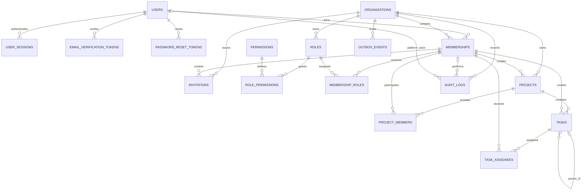

# WorkSphere Database Design

## Entity relationship diagram and physical-design baseline

**Version:** 1.1 review baseline

**Status:** Proposed; no migrations have been generated

**Database:** PostgreSQL

**Multi-tenancy:** Shared database and shared schema

This document is authoritative for Release 1 tables, keys and tenant-aware relationships. It implements the proposed decisions in the [ADR index](../adr/README.md). Human approval is required before migrations are created.

## 1. Design direction

- Users are global identities; memberships connect them to organizations.
- Permissions are global, predefined application capabilities and have no `organization_id`.
- Roles belong to organizations; role assignments belong to memberships.
- Projects and tasks are tenant-owned; tenant actors use membership references.
- Tenant-owned parents expose `UNIQUE (organization_id, id)` for composite references.
- Membership history is retained through lifecycle status.
- Flyway is the only migration mechanism. Production Hibernate validates and never mutates schemas.
- Timestamps are `TIMESTAMPTZ`; application/database operations use UTC.
- UUIDs are identifiers, not authorization evidence.

## 2. Release 1 ERD



`outbox_events` is introduced with the first reliable asynchronous email workflow; it is designed but not implemented. Task comments, labels, dependencies, teams, general notifications and analytics are deferred.

## 3. Identity

### `users`

| Column | Type | Constraints |
|---|---|---|
| id | UUID | PK |
| email | VARCHAR(320) | NOT NULL |
| normalized_email | VARCHAR(320) | NOT NULL, UNIQUE |
| password_hash | VARCHAR(255) | NOT NULL |
| first_name | VARCHAR(100) | NOT NULL |
| last_name | VARCHAR(100) | NOT NULL |
| display_name | VARCHAR(200) | NULL |
| status | VARCHAR(30) | NOT NULL |
| email_verified_at | TIMESTAMPTZ | NULL |
| created_at | TIMESTAMPTZ | NOT NULL |
| updated_at | TIMESTAMPTZ | NOT NULL |
| version | BIGINT | NOT NULL |

Email normalization is application-owned and versioned: trim surrounding whitespace, reject invalid Unicode/control characters, split at the final `@`, lowercase the domain using locale-independent rules, and initially lowercase the local part for WorkSphere matching. Preserve the submitted display email. Do not add provider-specific dot or plus-address rules. Suggested statuses: `PENDING_VERIFICATION`, `ACTIVE`, `LOCKED`, `DISABLED`, `ERASURE_PENDING`, `ANONYMIZED`.

### `user_sessions`

| Column | Type | Constraints |
|---|---|---|
| id | UUID | PK |
| user_id | UUID | NOT NULL, FK → users.id |
| token_hash | VARCHAR(255) | NOT NULL, UNIQUE |
| created_at | TIMESTAMPTZ | NOT NULL |
| idle_expires_at | TIMESTAMPTZ | NOT NULL |
| absolute_expires_at | TIMESTAMPTZ | NOT NULL |
| last_seen_at | TIMESTAMPTZ | NOT NULL |
| revoked_at | TIMESTAMPTZ | NULL |
| revocation_reason | VARCHAR(50) | NULL |
| ip_address | INET | NULL |
| user_agent | TEXT | NULL |

Check `idle_expires_at <= absolute_expires_at`. Authentication requires both expiries in the future and `revoked_at IS NULL`. The raw opaque token is returned only in the protected cookie and is never persisted or logged. See [ADR-005](../adr/ADR-005-server-managed-browser-sessions.md).

### `email_verification_tokens` and `password_reset_tokens`

Both contain `id UUID PK`, `user_id UUID NOT NULL FK`, `token_hash VARCHAR(255) NOT NULL UNIQUE`, `expires_at TIMESTAMPTZ NOT NULL`, `consumed_at TIMESTAMPTZ NULL`, and `created_at TIMESTAMPTZ NOT NULL`.

Consumption is one atomic conditional update requiring the matching hash, `consumed_at IS NULL`, and `expires_at > now()`. A unique constraint alone does not enforce single-use concurrency.

## 4. Organizations and memberships

### `organizations`

| Column | Type | Constraints |
|---|---|---|
| id | UUID | PK |
| name | VARCHAR(200) | NOT NULL |
| slug | VARCHAR(100) | NOT NULL |
| normalized_slug | VARCHAR(100) | NOT NULL, UNIQUE |
| status | VARCHAR(30) | NOT NULL |
| timezone | VARCHAR(100) | NOT NULL |
| created_at | TIMESTAMPTZ | NOT NULL |
| updated_at | TIMESTAMPTZ | NOT NULL |
| version | BIGINT | NOT NULL |

Slugs are globally unique. Normalize with Unicode normalization, locale-independent lowercase, an approved ASCII transliteration/rejection policy, `[a-z0-9-]`, collapsed hyphens and no leading/trailing hyphen. The implementation and reserved-slug list must be shared by validation and tested before migration.

### `memberships`

Contains `id UUID PK`, `organization_id UUID NOT NULL FK`, `user_id UUID NOT NULL FK`, `status VARCHAR(30) NOT NULL`, `joined_at`, `removed_at`, `created_at`, `updated_at` as `TIMESTAMPTZ`, and `version BIGINT NOT NULL`.

Constraints: `UNIQUE (organization_id, user_id)` and `UNIQUE (organization_id, id)`. Statuses: `INVITED`, `ACTIVE`, `SUSPENDED`, `REMOVED`. Rows are retained; removal changes state and revokes access.

### `invitations`

Contains `id UUID PK`, `organization_id UUID NOT NULL`, `invited_by_membership_id UUID NOT NULL`, `email`, `normalized_email`, `token_hash UNIQUE`, `status`, `expires_at`, `accepted_at`, `revoked_at`, and `created_at`.

Composite FK `(organization_id, invited_by_membership_id)` references memberships. Permit at most one pending invitation per organization/normalized email with a partial unique index where `status = 'PENDING'`. Statuses: `PENDING`, `ACCEPTED`, `EXPIRED`, `REVOKED`. Acceptance atomically checks expiry and unused status, consumes the invitation, and activates or creates membership. An already-active member cannot accept another invitation.

## 5. Authorization

### `permissions`

`id UUID PK`, `code VARCHAR(150) NOT NULL UNIQUE`, `description TEXT NULL`. Permissions are global immutable definitions, contain no `organization_id`, and are seeded only through reviewed migrations.

### `roles`

Contains `id UUID PK`, `organization_id UUID NOT NULL FK`, `name`, `normalized_name`, `description`, `role_type`, `created_at`, and `updated_at`. Constraints: `UNIQUE (organization_id, id)` and `UNIQUE (organization_id, normalized_name)`. `role_type` distinguishes protected `OWNER` from ordinary/custom roles.

### `role_permissions`

Columns: `organization_id`, `role_id`, `permission_id`. PK `(role_id, permission_id)`. Composite FK `(organization_id, role_id)` references roles; `permission_id` references the global permissions catalogue. The duplicated organization protects role ownership, not permission scope.

### `membership_roles`

Columns: `organization_id`, `membership_id`, `role_id`, `assigned_by_membership_id`, `assigned_at`. PK `(membership_id, role_id)`. Composite FKs reference membership, role and assigning membership through `(organization_id, id)`.

Ownership transfer is one transaction that locks relevant assignments, adds the new active owner, then optionally removes the previous owner. Removing, suspending or demoting the last active owner is an application invariant enforced with locking/serializable coordination; a row constraint cannot safely count active owners.

## 6. Projects

### `projects`

Contains `id UUID PK`, `organization_id UUID NOT NULL FK`, `name`, `description`, `status`, `priority`, `start_date`, `due_date`, `created_by_membership_id`, timestamps, `archived_at`, and `version`. Require `UNIQUE (organization_id, id)`, a composite creator FK to memberships, and `CHECK (due_date IS NULL OR start_date IS NULL OR due_date >= start_date)`.

### `project_members`

Columns: `organization_id`, `project_id`, `membership_id`, `project_role`, `added_by_membership_id`, `added_at`. PK `(project_id, membership_id)`. Composite FKs reference project, participant membership and adding membership within the same organization.

## 7. Tasks

### `tasks`

Contains `id UUID PK`, `organization_id`, `project_id`, nullable `parent_task_id`, `title`, `description`, `status`, `priority`, `due_at`, `created_by_membership_id`, timestamps, `completed_at`, and `version`.

Required constraints:

- `UNIQUE (organization_id, id)` for tenant references.
- `UNIQUE (organization_id, project_id, id)` for parent references.
- FK `(organization_id, project_id)` → projects.
- FK `(organization_id, created_by_membership_id)` → memberships.
- FK `(organization_id, project_id, parent_task_id)` → tasks `(organization_id, project_id, id)`.
- `CHECK (parent_task_id IS NULL OR parent_task_id <> id)`.

The parent FK guarantees the same organization and project. Preventing longer cycles is an application invariant checked transactionally because ordinary checks/FKs cannot traverse an arbitrary hierarchy.

### `task_assignees`

Columns: `organization_id`, `task_id`, `membership_id`, `assigned_by_membership_id`, `assigned_at`. PK `(task_id, membership_id)`. Composite FKs reference task, assignee and assigning membership in the organization. Application policy additionally requires active membership and, if configured, project membership.

## 8. Audit and outbox

### `audit_logs`

Contains `id UUID PK`, nullable `organization_id`, nullable `actor_membership_id`, nullable `platform_actor_user_id FK`, `action`, `resource_type`, nullable `resource_id`, `outcome`, nullable `ip_address`, `user_agent`, `metadata JSONB`, and `created_at`.

Tenant events use composite actor membership. Platform events may use a platform actor; customer support access is never implied. Add a check preventing ambiguous simultaneous actor types. The application role may insert and perform authorized reads but may not update/delete. Secrets and unnecessary personal data are prohibited. Provisional retention is at least 365 days for security/authorization events, pending legal and customer policy.

### `outbox_events`

Contains `id UUID PK` (the idempotency key), nullable `organization_id`, `aggregate_type`, `aggregate_id`, `event_type`, `event_version`, `payload JSONB`, `occurred_at`, `available_at`, `attempt_count`, `status`, `claimed_at`, `processed_at`, and `last_error_code`.

Persist it atomically with the business change. Workers claim safely (for example `FOR UPDATE SKIP LOCKED`), use exponential backoff with jitter, at-least-once delivery and stable idempotency keys. Exhausted/permanent failures enter `FAILED`, alert operators and support controlled replay. Raw invitation, verification and reset secrets are not stored in general payloads. See [ADR-008](../adr/ADR-008-transactional-outbox-strategy.md).

## 9. Delete, retention and erasure rules

| Relationship | Initial behavior |
|---|---|
| User → memberships/audit | `RESTRICT`; use anonymization/erasure workflow |
| Organization → tenant data | `RESTRICT`; close then purge only through approved retention workflow |
| Membership → roles/project/task/audit | `RESTRICT`; retain row and change status |
| Role → assignments | `RESTRICT` while assigned |
| Project → tasks/members | `RESTRICT`; archive in normal flow |
| Task → assignees | `CASCADE` only during a controlled hard purge |
| Session/token → user | `CASCADE` permitted during approved hard erasure |
| Outbox/audit | Never cascade from mutable business entities |

User erasure revokes sessions/tokens, removes or anonymizes direct profile identifiers, retains only required pseudonymous membership/audit evidence, and ages data from logs/backups under documented retention. Exact legal bases and periods require privacy approval.

## 10. Enforcement boundary

Database-enforced:

- PK/FK, composite tenant consistency and uniqueness.
- One membership per organization/user and one pending invitation per organization/email.
- Same-project/same-organization task parent.
- Simple checks, optimistic-lock columns and restricted audit privileges.

Application-enforced transactionally where needed:

- Authentication, active membership, permissions and resource access.
- Last-active-owner protection and ownership transfer.
- Invitation eligibility and acceptance; token expiry and single-use consumption.
- Task hierarchy cycle prevention and allowed status transitions.
- Active/project membership rules for assignees.
- Retention, erasure and delivery behavior.

## 11. Initial index candidates

```sql
CREATE INDEX idx_memberships_user_status ON memberships (user_id, status);
CREATE INDEX idx_memberships_org_status ON memberships (organization_id, status);
CREATE INDEX idx_projects_org_status_created ON projects (organization_id, status, created_at DESC);
CREATE INDEX idx_project_members_membership ON project_members (organization_id, membership_id);
CREATE INDEX idx_tasks_org_project_status_due ON tasks (organization_id, project_id, status, due_at);
CREATE INDEX idx_task_assignees_membership ON task_assignees (organization_id, membership_id);
CREATE INDEX idx_sessions_user_active ON user_sessions (user_id, absolute_expires_at) WHERE revoked_at IS NULL;
CREATE INDEX idx_audit_org_created ON audit_logs (organization_id, created_at DESC);
CREATE INDEX idx_outbox_pending ON outbox_events (available_at, occurred_at) WHERE status = 'PENDING';
```

Validate candidates with PostgreSQL query plans. PostgreSQL does not automatically index every referencing FK.

## 12. Migration and test gates

No migrations are created by this documentation task. After human approval, implement small reviewed migrations in dependency order. Never edit an applied shared migration.

PostgreSQL Testcontainers must prove cross-tenant reads/writes are denied; invalid cross-tenant role/project/task/actor relationships fail; task parents cannot cross project/tenant; inactive memberships lose access; last-owner protection survives concurrency; tokens/invitations are single-use; revoked/expired sessions fail across instances; outbox writes are atomic and retries idempotent; and application credentials cannot mutate audit data.

## 13. Human approvals still required

- ADR acceptance and final permission catalogue.
- Session timeouts, concurrent-session limit, rate limits and CSRF mechanism.
- Invitation lifetime and reactivation behavior.
- Reserved slugs and exact normalization implementation.
- Owner-transfer authorization and emergency recovery.
- Audit/outbox/application retention and privacy/legal erasure policy.
- Deployment backup, PITR, RPO/RTO and database privileges.
